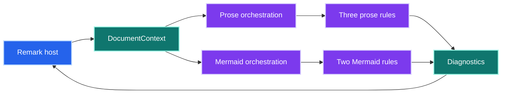
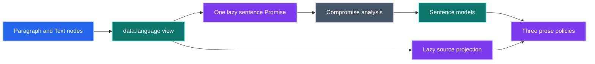
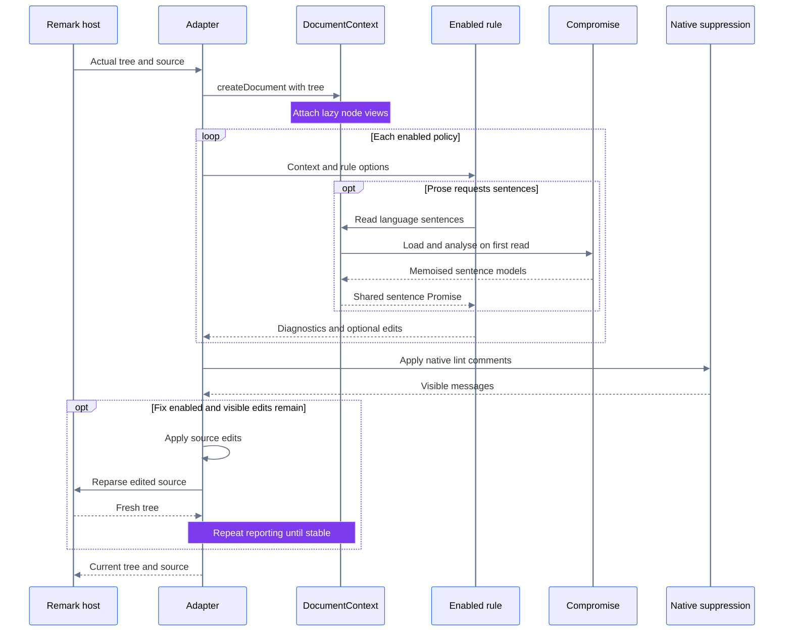
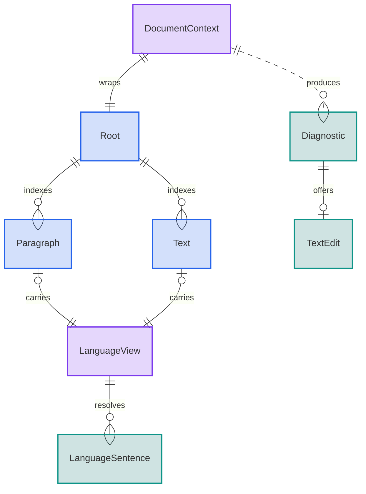
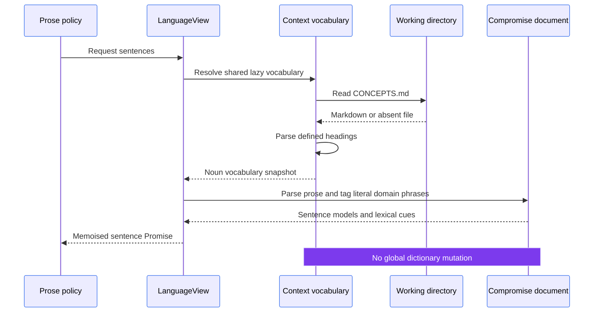

# Documentation lint architecture

This package separates five Markdown policies from shared document models, language analysis and Mermaid infrastructure.
The [remark adapter](src/remark/plugin.ts) owns configuration, native suppression and optional source edits.
All models and caches are transient process memory.
See [contributing](CONTRIBUTING.md) to add a policy.
The [root export](index.ts) is a separate upstream recommended remark preset; custom policies require `remark-lint-stopslop/remark`.

## Package boundaries

Which components own parsing, policy and reporting?

The host supplies its actual mdast tree to [`createDocument`](src/document/context.ts).
String callers use the shared remark parser with GFM and frontmatter support.
The [prose orchestrator](src/prose/analyze.ts) and [Mermaid orchestrator](src/mermaid/analyze.ts) dispatch enabled rules without evaluating disabled policies.
The remark adapter loads the Mermaid subsystem only when a Mermaid policy runs.
Prose-only configurations do not initialise Mermaid or install its browser globals.

| Policy file | Responsibility |
| --- | --- |
| [`prose/rules/sentence-one-per-line.ts`](src/prose/rules/sentence-one-per-line.ts) | Detect sentence layout and expose verified whitespace edits |
| [`prose/rules/sentence-word-budget-exceeded.ts`](src/prose/rules/sentence-word-budget-exceeded.ts) | Enforce the word budget and suggest shorter sentences |
| [`prose/rules/paragraph-sentence-budget-exceeded.ts`](src/prose/rules/paragraph-sentence-budget-exceeded.ts) | Enforce the sentence budget and suggest lexical groups |
| [`mermaid/contrast/policy.ts`](src/mermaid/contrast/policy.ts) | Audit rendered text surfaces in both themes |
| [`mermaid/complexity/policy.ts`](src/mermaid/complexity/policy.ts) | Calculate VCS and report verified split recommendations |

[`types.ts`](src/types.ts) defines common options, diagnostics and edits.
[`rules.ts`](src/rules.ts) lists the five policy identifiers.
Mermaid parse failures are supporting diagnostics, not a sixth configurable policy.

## Shared prose analysis

How do three policies reuse language work without reparsing the host tree?

[`DocumentContext`](src/document/context.ts) indexes paragraphs and text nodes, then attaches one `data.language` view to each.
The view exposes projected text without starting NLP.
Its non-enumerable `sentences` getter dynamically loads Compromise and memoises one Promise per view.
[`LanguageView`](src/document/language-view.ts) supplies sentence boundaries, word counts, clause signals and lexical cohesion cues.
These cues guide edits; they do not guarantee semantic topic boundaries.
The [paragraph planner](src/prose/paragraph-plan.ts) owns policy-specific lexical grouping and budget-respecting break selection.
The document language model supplies sentences without depending on prose policy.

Projection maps decoded text back to original UTF-16 offsets, including escapes and entities.
Layout edits must preserve the parsed structure and visible words, both individually and as a batch.
Table paragraphs are excluded from running prose; blockquotes and explicit hard breaks remain lint-only for layout.

## Mermaid analysis and split planning

The [Mermaid subsystem](src/mermaid/README.md) selects actual fences from the host tree and serialises analysis around mutable official parser and theme state.
Its two policies score visual complexity and rendered text contrast, including both viewer themes.
Parse failures become errors for the selected policy; disabled policies do not run.
Bounded caches reuse canonical parser results while diagnostics always reflect the current host tree.

The [split planner](src/mermaid/splitting/README.md) can recommend overview and detail diagrams after independent recoverability, emitted-source and information-loss checks.
Mermaid policies provide guidance without automatic edits.
Sequence diagrams are not split because graph extraction would discard message order.

## Event model: remark execution and fixes

When does lazy analysis run, and which findings may change source?

Suppression runs before the adapter selects fixes.
Only visible `sentence-one-per-line` findings can expose edits.
[`applyEdits`](src/document/edits.ts) rejects overlapping ranges and applies edits from the end of the source.
The adapter reparses after each changed round and reports again until stable.
Its compiler returns the edited source, preserving unrelated formatting instead of serialising the entire Markdown tree.

## Data model: transient relationships

Which objects are shared during one analysed document revision?

`LanguageSentence` is the sentence model from [`document/language-view.ts`](src/document/language-view.ts).
Each view belongs to one paragraph or text node, and resolves zero or more sentences on demand.
Each diagnostic contains a rule identifier, message and absolute UTF-16 range; its optional edit contains a replacement range and text.
Diagnostics are returned results, not stored fields on `DocumentContext`.

Containment edges summarise descendants rather than immediate mdast parent relationships.
Each reporting round creates its own document context.
Node projections and language views live in context-local WeakMaps.
[`memoBySource`](src/mermaid/parsing/engine.ts) bounds official parser-result caches and returns cloned values.
The adapter recomputes diagnostics from the actual tree; it has no cross-document diagnostic cache.
No database or message broker participates in these relationships.

## Project vocabulary lifecycle

How does an optional concepts file influence language analysis?

[`concepts.ts`](src/document/concepts.ts) uses `VFile.cwd` through the adapter.
Direct `createDocument` callers can pass `cwd`, which defaults to the process working directory.
Only that directory's `CONCEPTS.md` is inspected; there is no ancestor search.
The first sentence request reads the file, and every view in that context shares its vocabulary snapshot.
Fresh contexts, including fixer rounds, read a fresh snapshot when requested.
Absent files yield an empty vocabulary; other file-access failures propagate.
Mermaid-only runs and unrequested language views do not read concepts or load NLP.

Definitions use a level-two or deeper heading followed immediately by a paragraph.
Inline formatting is removed, whitespace is normalised and matching is case-insensitive.
Titles, fenced examples, tables and definition prose do not become vocabulary.
List-only glossaries and implicit aliases are not extracted; document each alias as its own entry.

Terms become nouns in each Compromise sentence document through literal lookup and tagging.
The global dictionary stays unchanged because Compromise's lexicon constructor argument calls its global `addWords` internally.
Definitions enrich lexical guidance rather than teaching semantic meaning or adding a lint policy.
Word budgets still count visible whitespace-delimited words; a multiword term is not counted as one word.
