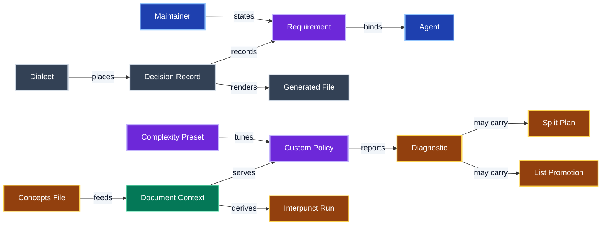

# Glossary

The ubiquitous language for `@jpeakai/remark-lint-slopstopper`.
Each term is written in Title Case wherever it is used, to mark it as this glossary's meaning rather than the plain-language one.
When a new domain term enters the code or the conversation, add it here in the same change.
Give it its own H2 and a place in the diagram.

## Agent

An AI coding assistant working in this repo, such as Claude Code or Codex.
Every Agent is bound by the instructions in [AGENTS.md](AGENTS.md).

## Complexity Preset

A named set of visual complexity thresholds for Mermaid diagrams, such as `high-density` or `low-density`.
It is distinct from the root export, which is an upstream remark-lint preset.
Definitions live in [`metrics.ts`](src/mermaid/complexity/metrics.ts).

## Concepts File

The `CONCEPTS.md` in the working directory whose headings name project terms for the prose policies.
Only the term names are read, and a missing file is not an error.

## Custom Policy

One of this package's own lint rules, enabled through `@jpeakai/remark-lint-slopstopper/remark`.
Each has a full identifier such as `prose/sentence-one-per-line`, listed in [`src/rules.ts`](src/rules.ts).

## Decision Record

One accepted decision in [`adrs/`](adrs/), authored as YAML with its markdown generated.
It is never rewritten, and a later Decision Record supersedes it through a typed relation.

## Diagnostic

One finding a Custom Policy reports, carrying its full identifier, a message and a source range.
Its shape is defined in [`src/types.ts`](src/types.ts).

## Dialect

This repo's declared documentation conventions, in [docs/CONVENTIONS.md](docs/CONVENTIONS.md).

## Document Context

The shared, lazily built view of one markdown document that every Custom Policy reads.
It is created by [`createDocument`](src/document/context.ts).

## Generated File

A file rendered from a source by `make fix`, and never edited by hand.

## Interpunct Run

A running paragraph whose prose joins items with interpuncts.
On one source line it is a flat list; stacked over several lines it is a two-level structure.
It is derived in [`interpunct-runs.ts`](src/document/interpunct-runs.ts).

## List Promotion

The automatic edit that turns a list hidden in running prose into a lead-in line and a real Markdown list.
Item text is sliced from the source, and the edit is verified against the list it declares.
It is built in [`promotion.ts`](src/prose/promotion.ts).

## Maintainer

The owner of this repo.
Only the Maintainer states a Requirement.

## Requirement

Something the Maintainer has stated the project must do or must never do.

## Split Plan

A verified recommendation for breaking one over-complex Mermaid diagram into smaller ones.
See [the splitting README](src/mermaid/splitting/README.md).
