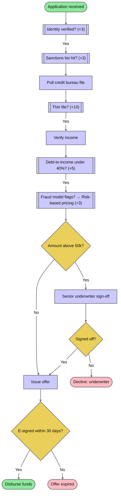
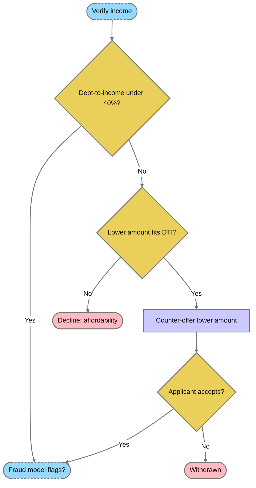
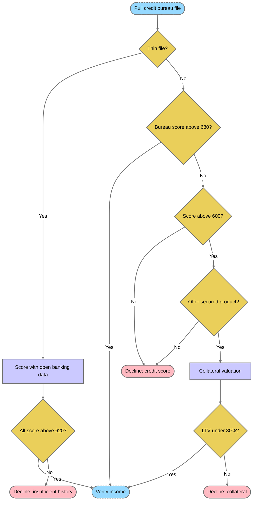
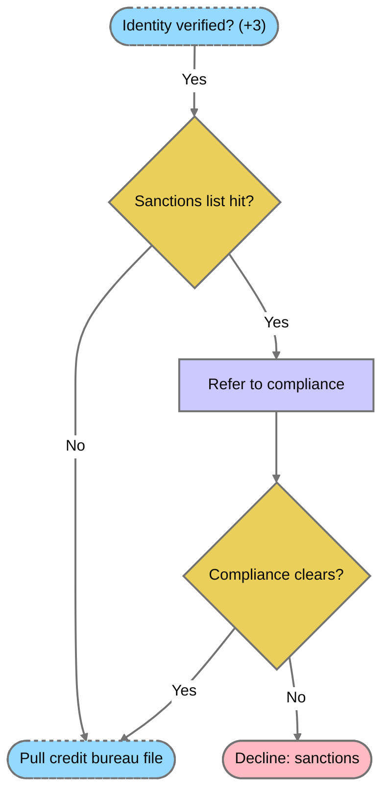
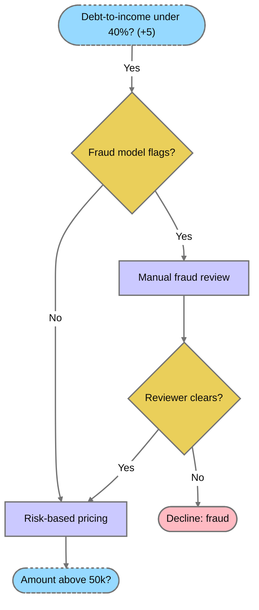
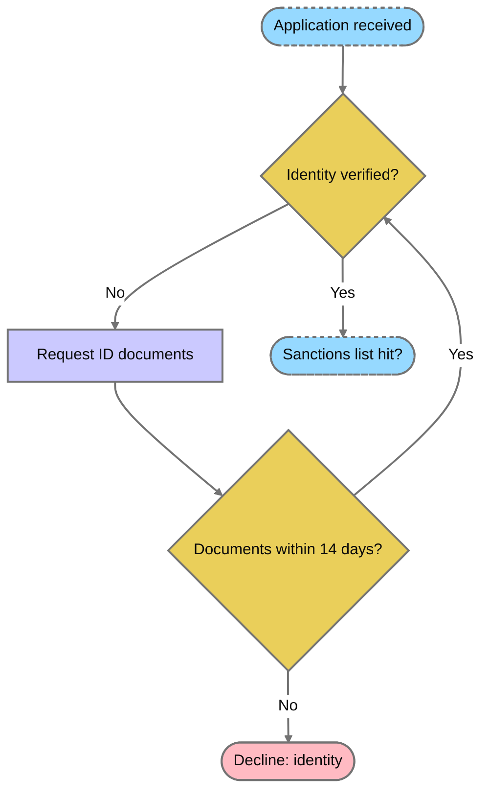

# Loan underwriting decisions

The overview links to complete decision details below.
Dashed nodes identify boundaries with another view.

## Overview

## Affordability (g1)

## Credit history and collateral (g2)

## Sanctions (g3)

## Fraud and pricing (g4)

## Identity (g5)

