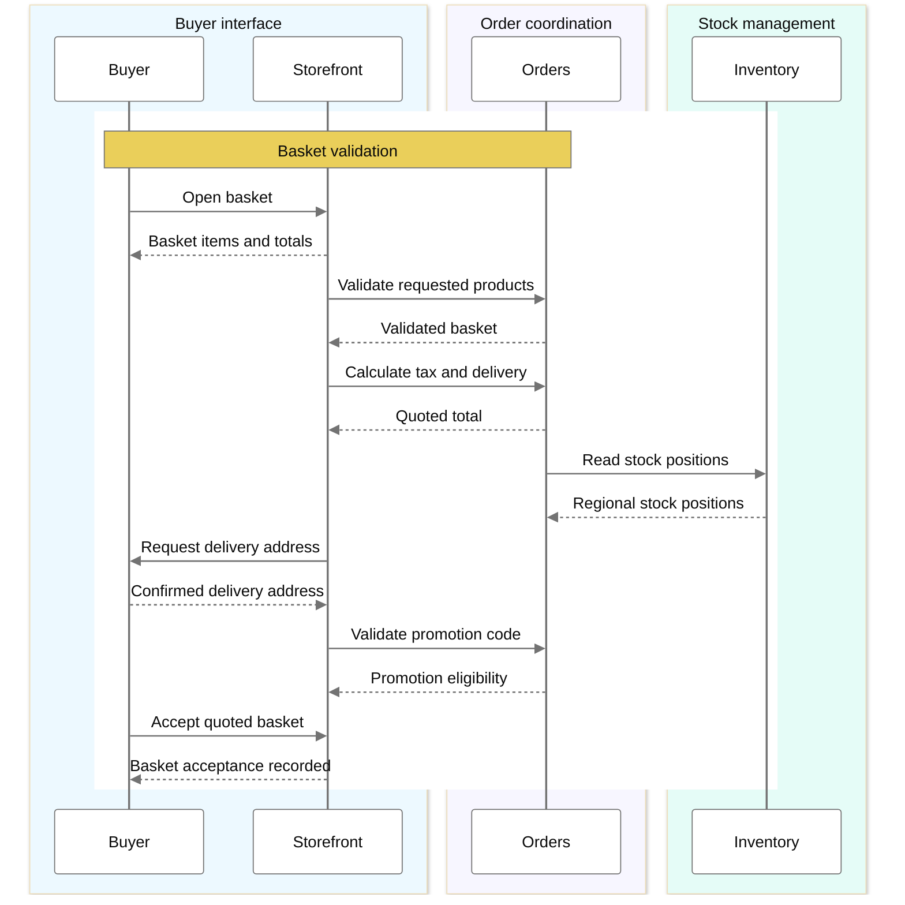
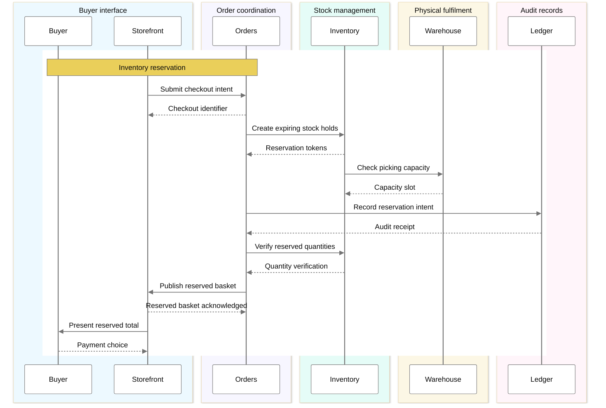
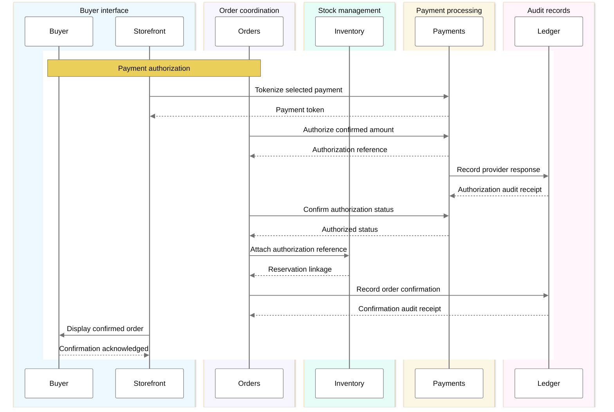
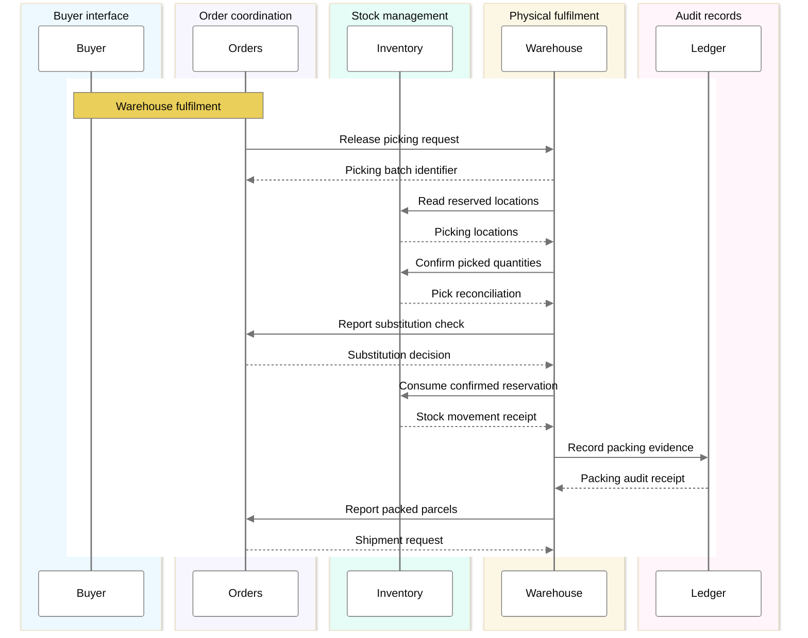
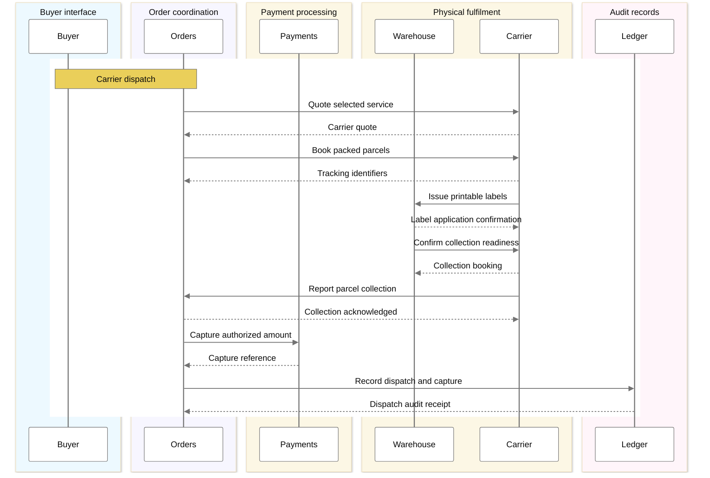
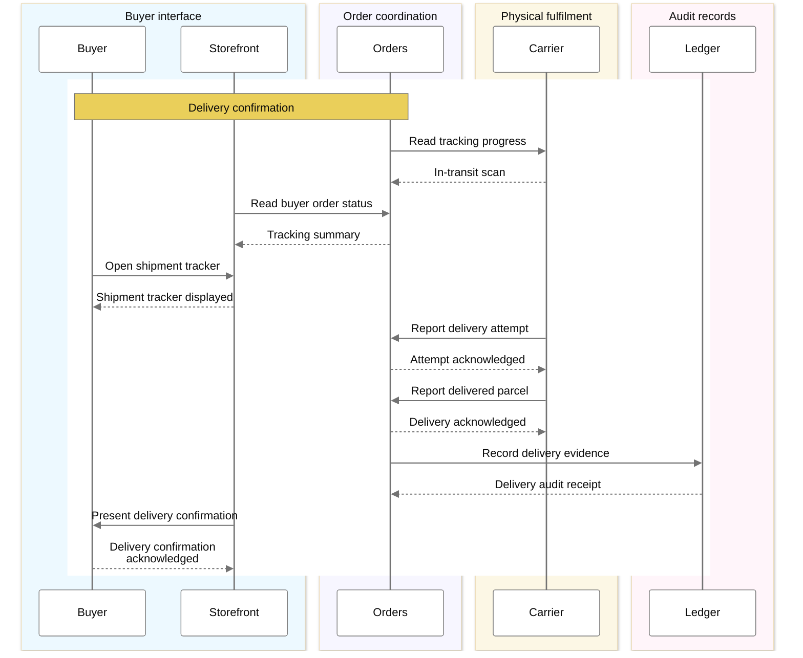
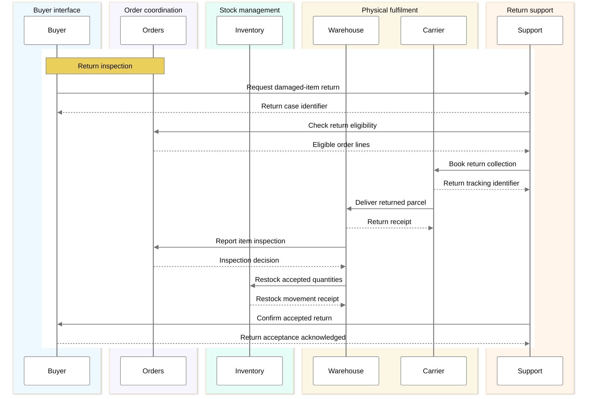
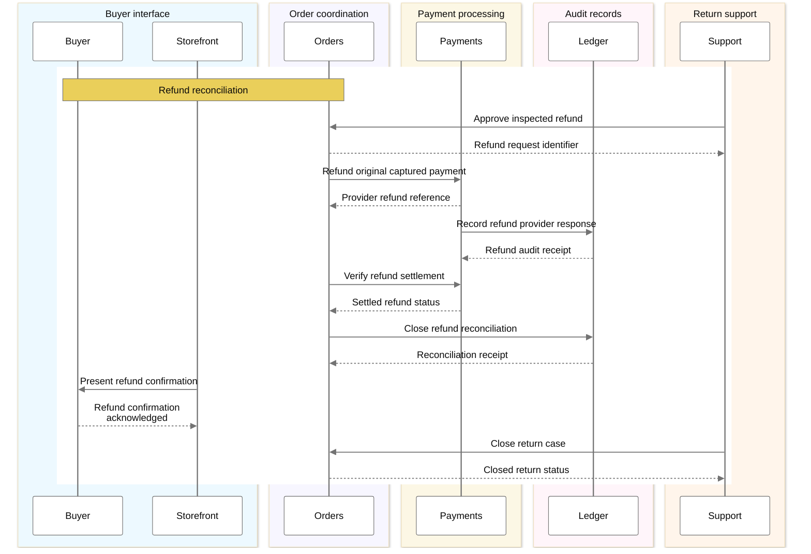

# Purchase delivery return and refund lifecycle

The phases retain the complete interaction order.
Participant colours identify responsibilities across views.

## Basket validation

## Inventory reservation

## Payment authorization

## Warehouse fulfilment

## Carrier dispatch

## Delivery confirmation

## Return inspection

## Refund reconciliation

