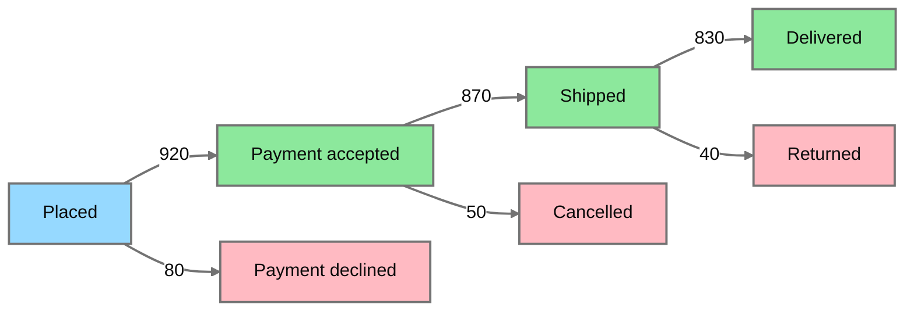

# Order disposition volumes

Family detector: `sankey`.

Volumes appear on directed edges because Sankey bands use fixed blending that fails dark-canvas contrast.
Edge widths do not encode volume in this view.

