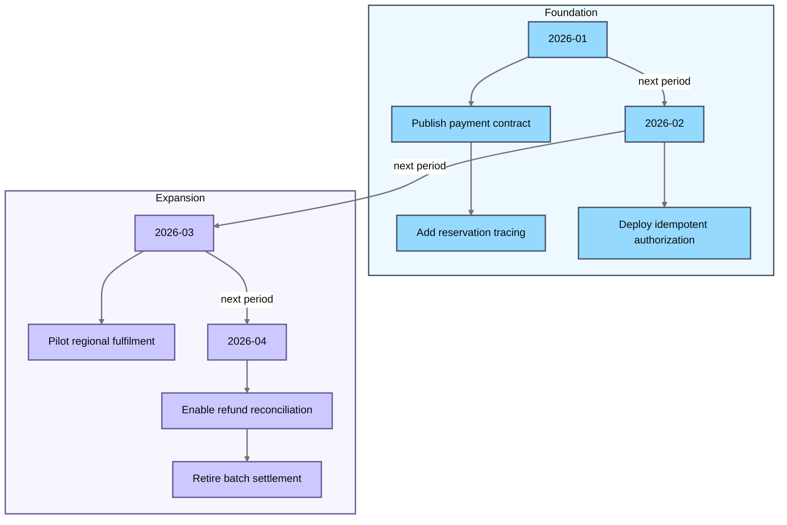

# Checkout migration milestones

Family detector: `timeline`.

The timeline is represented as a flowchart because native timeline arrowheads fail dark-theme contrast.
Period arrows show chronology; each period branches to its events in source order.

