# Fixed multiple-diagram corpus

These revisions address the input document's lint findings while preserving its diagram facts.
Beta input families require Mermaid 11.17.2 or newer.
C4, TreeView and Cynefin outputs use portable styled flowcharts where native fixed-color surfaces prevent a reliable dual-theme result.

## Shop architecture

The contract-verified overview and details pair every label with a readable palette background.
All original nodes, relationships and decision labels remain recoverable across these views.

### Shop architecture overview

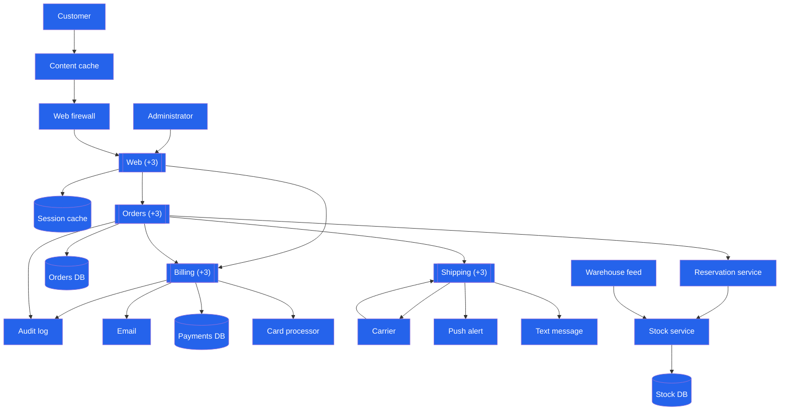

### Shop architecture detail g1

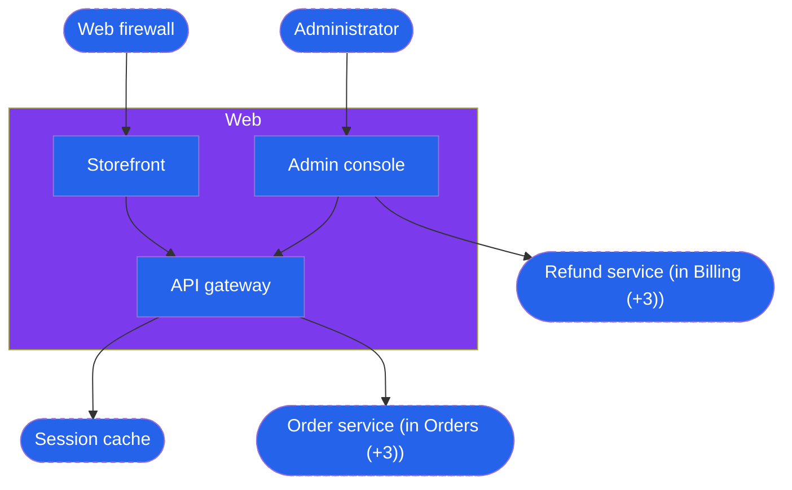

### Shop architecture detail g2

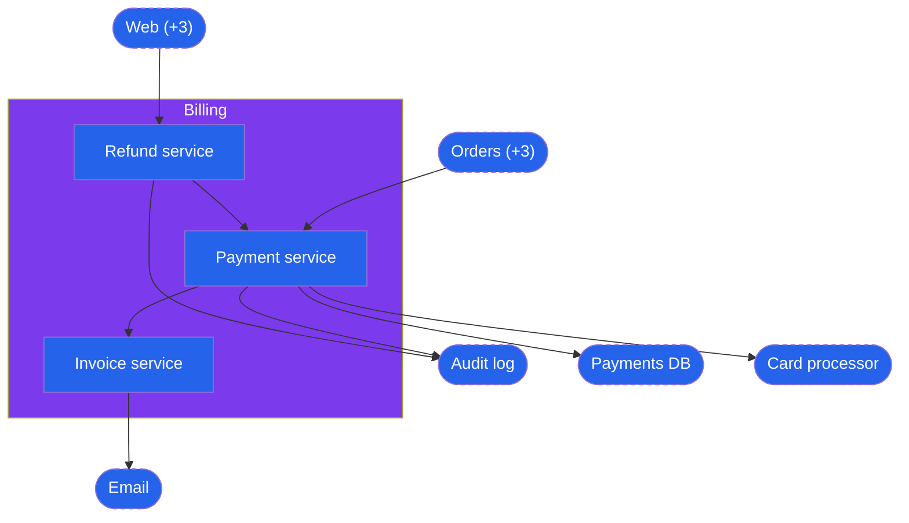

### Shop architecture detail g3

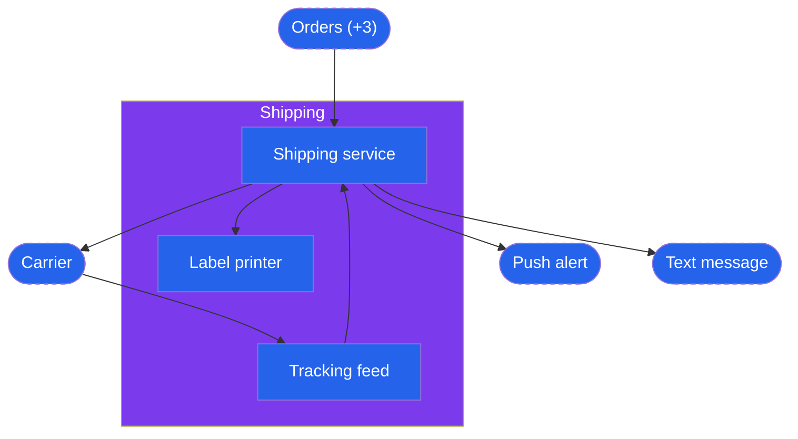

### Shop architecture detail g4

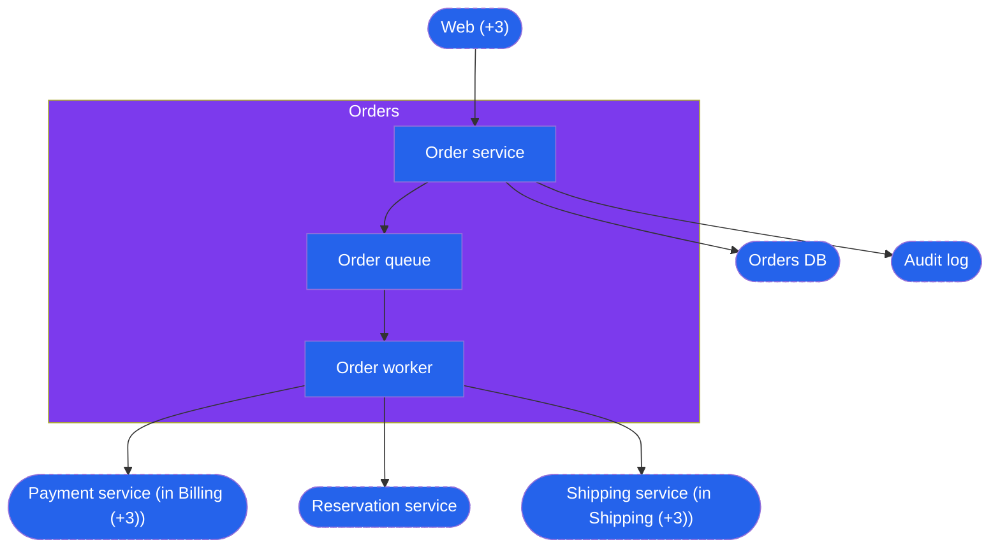

## Loan underwriting decisions

The contract-verified overview and details pair every label with a readable palette background.
All original nodes, relationships and decision labels remain recoverable across these views.

### Loan underwriting decisions overview

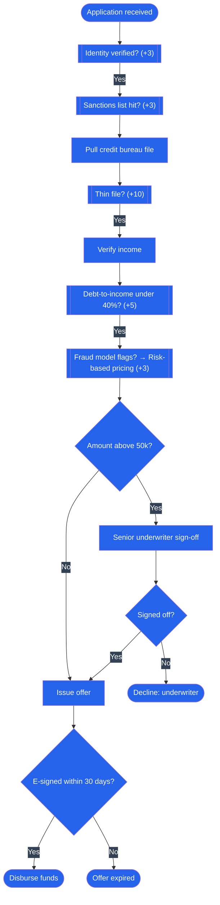

### Loan underwriting decisions detail g1

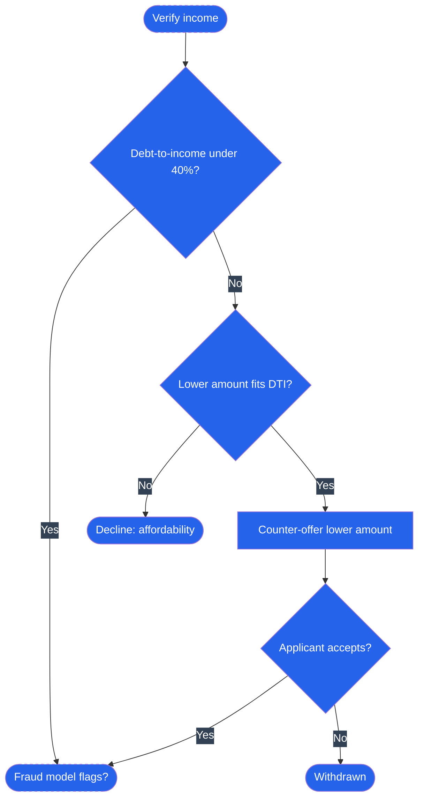

### Loan underwriting decisions detail g2

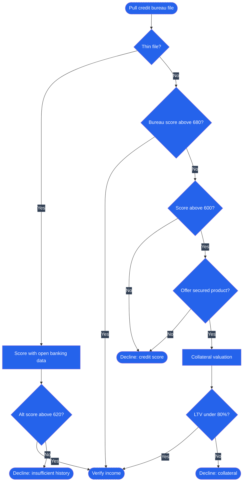

### Loan underwriting decisions detail g3

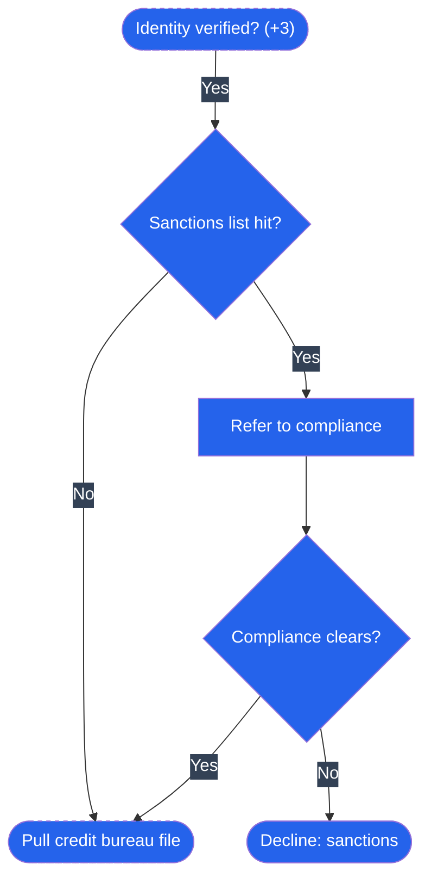

### Loan underwriting decisions detail g4

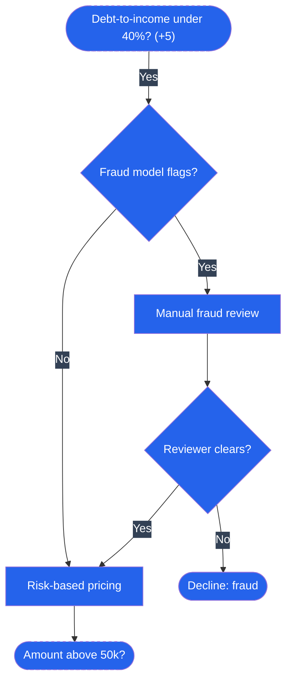

### Loan underwriting decisions detail g5

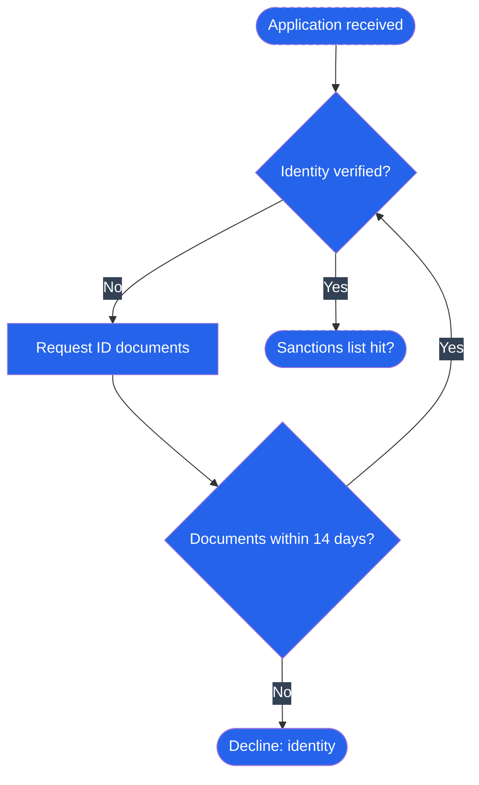

## Repaired label and style isolation

The repaired white-on-white label keeps its text and node identifier.
The following reused identifier retains its independent default theme.

### Repaired label

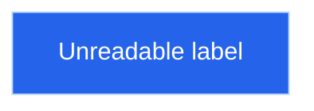

### Independent default label

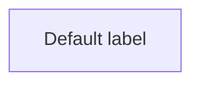

## Legacy returns routing

Input family: flowchart.
Pair opaque blue node fills with explicit white node text.
use a slate label backing and violet lane backgrounds.

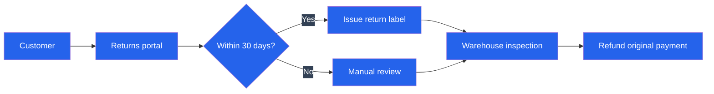

## Regional order routing

Input family: flowchart-elk.
Pair opaque blue node fills with explicit white node text.
use a slate label backing and violet lane backgrounds.

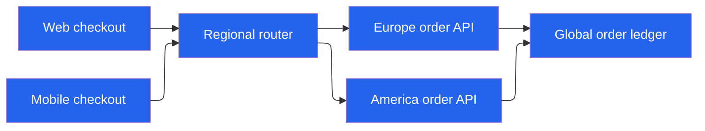

## Order domain classes

Input family: classDiagram.
Replace the deliberately unreadable theme override with the verified default theme colors.

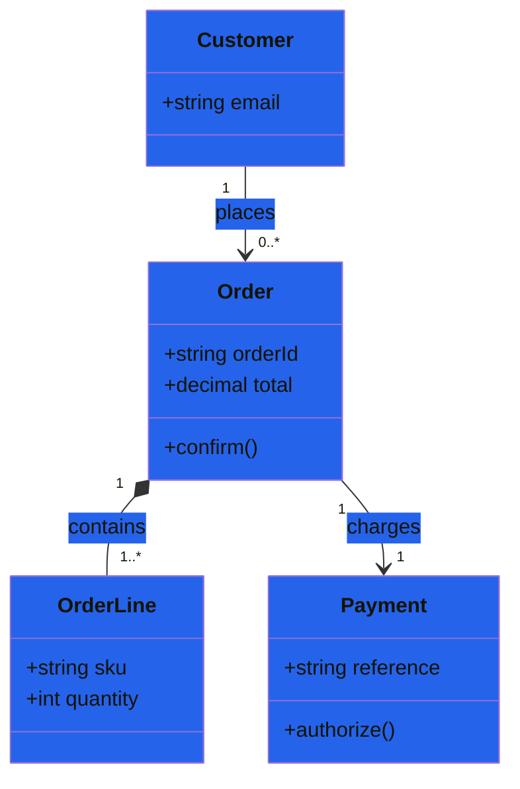

## Legacy inventory interfaces

Input family: class.
Replace the deliberately unreadable theme override with the verified default theme colors.

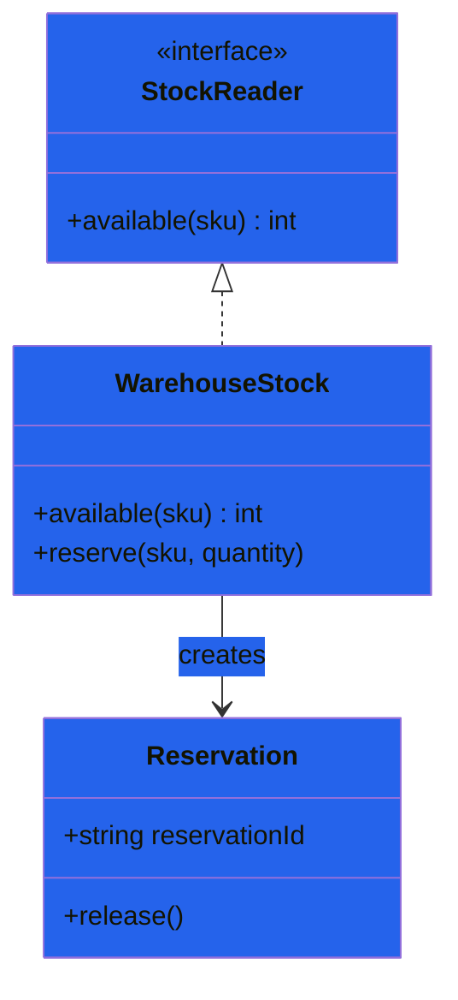

## Order storage relationships

Input family: er.
Set both actual attribute-row backgrounds and their text together.
give relationship labels an opaque slate backing.

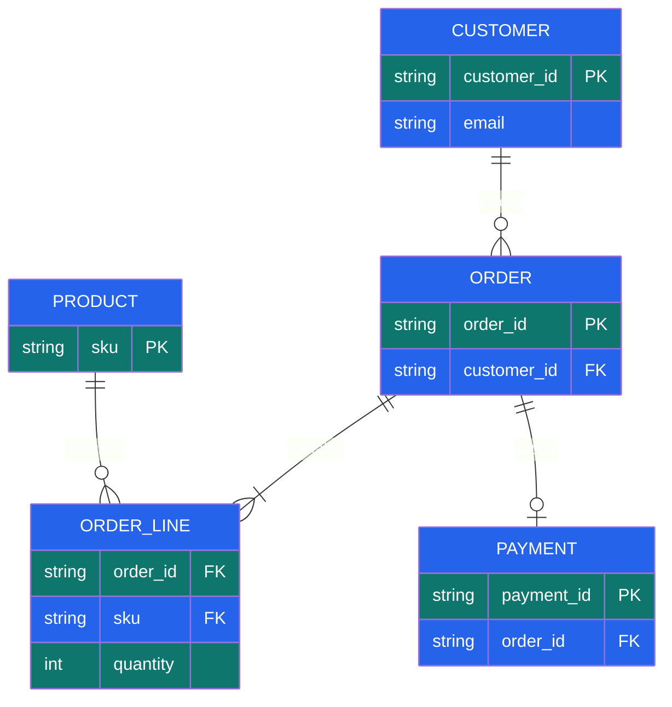

## Checkout authorization sequence

Input family: sequence.
Replace the deliberately unreadable theme override with the verified default theme colors.

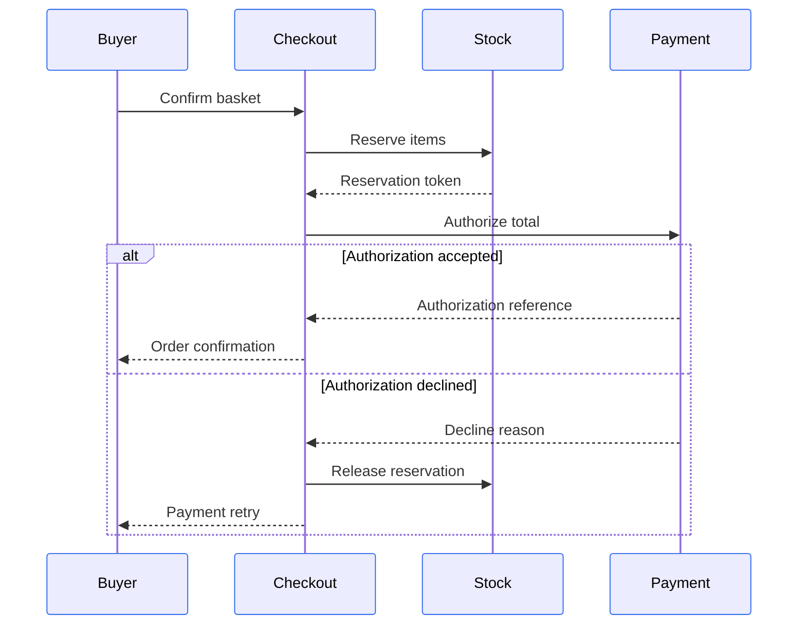

## Legacy payment lifecycle

Input family: stateDiagram.
Pair opaque blue node fills with explicit white node text.
use a slate label backing and violet lane backgrounds.

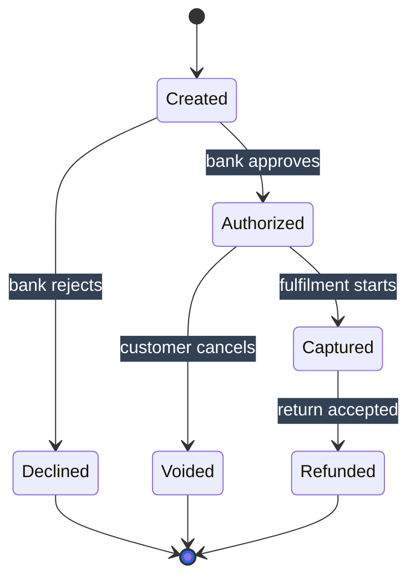

## Reservation lifecycle

Input family: state.
Pair opaque blue node fills with explicit white node text.
use a slate label backing and violet lane backgrounds.

```mermaid
---
config: {"themeVariables":{"primaryColor":"#2563eb","primaryTextColor":"#fff","primaryBorderColor":"#bfdbfe","mainBkg":"#2563eb","secondaryColor":"#0f766e","secondaryTextColor":"#fff","tertiaryColor":"#7c3aed","tertiaryTextColor":"#fff","edgeLabelBackground":"#334155","nodeTextColor":"#fff","textColor":"#fff","titleColor":"#fff","clusterBkg":"#7c3aed","transitionLabelColor":"#fff"}}
---
stateDiagram-v2
  [*] --> Pending
  Pending --> Held : inventory reserved
  Pending --> Rejected : no stock
  Held --> Confirmed : payment authorized
  Held --> Released : payment declined
  Held --> Expired : fifteen minutes elapsed
  Confirmed --> [*]
  Rejected --> [*]
  Released --> [*]
  Expired --> [*]
```

## Returns responsibility lanes

Input family: swimlane.
Pair opaque blue node fills with explicit white node text.
use a slate label backing and violet lane backgrounds.

```mermaid
---
config: {"themeVariables":{"primaryColor":"#2563eb","primaryTextColor":"#fff","primaryBorderColor":"#bfdbfe","mainBkg":"#2563eb","secondaryColor":"#0f766e","secondaryTextColor":"#fff","tertiaryColor":"#7c3aed","tertiaryTextColor":"#fff","edgeLabelBackground":"#334155","nodeTextColor":"#fff","textColor":"#fff","titleColor":"#fff","clusterBkg":"#7c3aed"}}
---
swimlane-beta LR
  subgraph Customer
    Request[Request return] --> Pack[Pack parcel]
  end
  subgraph Support
    Approve[Approve eligibility]
    Notify[Notify refund]
  end
  subgraph Warehouse
    Inspect[Inspect parcel] --> Restock[Restock items]
  end
  Request --> Approve
  Approve --> Pack
  Pack --> Inspect
  Restock --> Notify
```

## Fulfilment readiness checklist

Input family: mindmap.
Pair the root and each semantic branch color with explicit white labels, including every child in that branch.

```mermaid
---
config: {"themeVariables":{"git0":"#2563eb","gitBranchLabel0":"#fff","cScale1":"#2563eb","cScaleLabel1":"#fff","cScale2":"#0f766e","cScaleLabel2":"#fff","cScale3":"#7c3aed","cScaleLabel3":"#fff","cScale4":"#2563eb","cScaleLabel4":"#fff","cScale5":"#0f766e","cScaleLabel5":"#fff","cScale6":"#7c3aed","cScaleLabel6":"#fff","cScale7":"#2563eb","cScaleLabel7":"#fff","cScale8":"#0f766e","cScaleLabel8":"#fff","cScale9":"#7c3aed","cScaleLabel9":"#fff","cScale10":"#2563eb","cScaleLabel10":"#fff","cScale11":"#0f766e","cScaleLabel11":"#fff"}}
---
mindmap
  root((Fulfilment readiness))
    Inventory
      Stock reconciliation
      Safety stock
    Operations
      Carrier capacity
      Warehouse staffing
    Reliability
      Queue recovery
      Payment reconciliation
```

## Checkout infrastructure

Input family: architecture.
Use palette borders for infrastructure groups and maintain theme-adaptive labels.
preserve every service, group and connection.

```mermaid
---
config: {"themeVariables":{"archEdgeColor":"#64748b","archEdgeArrowColor":"#64748b","archGroupBorderColor":"#2563eb"}}
---
architecture-beta
  group edge(cloud)[Public edge]
  group core(cloud)[Private services]
  service gateway(server)[Gateway] in edge
  service orders(server)[Orders] in core
  service database(database)[Order database] in core
  service queue(disk)[Fulfilment queue] in core
  gateway:R --> L:orders
  orders:B --> T:database
  orders:R --> L:queue
```

## Checkout system context

Input family: c4.
Translate C4 to a styled flowchart because native C4 relationship labels use a fixed foreground without a backing.
Preserve every person, system description, external boundary and labeled relationship.

```mermaid
---
config: {"themeVariables":{"nodeTextColor":"#fff","textColor":"#fff","titleColor":"#fff","mainBkg":"#2563eb","primaryColor":"#2563eb","primaryTextColor":"#fff","primaryBorderColor":"#bfdbfe","clusterBkg":"#7c3aed","edgeLabelBackground":"#334155"}}
---
flowchart LR
  Buyer["Person Buyer: places and tracks orders"]:::ingress
  Checkout["System Checkout: creates confirmed orders"]:::compute
  Bank["External system Card processor: authorizes payments"]:::infra
  Carrier["External system Carrier: ships confirmed orders"]:::infra
  Buyer -->|Places orders| Checkout
  Checkout -->|Authorizes total| Bank
  Checkout -->|Books shipment| Carrier
  classDef ingress fill:#2563eb,stroke:#bfdbfe,color:#fff
  classDef compute fill:#7c3aed,stroke:#ddd6fe,color:#fff
  classDef infra fill:#475569,stroke:#cbd5e1,color:#fff
```

## Checkout release work

Input family: kanban.
Remove the fixed white text override and use blue borders while keeping adaptive text for lane headings and cards.

```mermaid
---
config: {"themeVariables":{"primaryBorderColor":"#2563eb"}}
---
kanban
  backlog[Backlog]
    tracing[Trace failed payments]
    export[Export refund evidence]
  progress[In progress]
    retry[Bound authorization retries]
    stock[Reconcile stock reservations]
  review[Review]
    alert[Review payment alerts]
  done[Done]
    receipt[Send order receipts]
```

## Warehouse rollout schedule

Input family: gantt.
Darken actual task bars to palette blue and retain adaptive text for responsive labels outside the bars.

```mermaid
---
config: {"themeVariables":{"taskTextColor":"#fff","taskBkgColor":"#2563eb","taskBorderColor":"#bfdbfe"}}
---
gantt
  dateFormat YYYY-MM-DD
  section Preparation
  Inventory audit :audit, 2026-11-02, 3d
  Staff training :train, after audit, 2d
  section Rollout
  Pilot warehouse :pilot, after train, 4d
  Carrier validation :carrier, after pilot, 2d
  Regional launch :launch, after carrier, 1d
```

## Parser compatibility identity

Input family: info.
Replace the deliberately unreadable theme override with the verified default theme colors.

```mermaid
info
```

## Refund reason distribution

Input family: pie.
Pair each reason slice with an opaque palette fill and white percentage text.
keep the original distribution and adaptive legend labels.

```mermaid
---
config: {"themeVariables":{"pie1":"#2563eb","pie2":"#0f766e","pie3":"#7c3aed","pie4":"#475569","pieSectionTextColor":"#fff","pieOpacity":1}}
---
pie
  "Damaged in transit": 34
  "Incorrect item": 22
  "Changed mind": 28
  "Late delivery": 16
```

## Reservation safety requirements

Input family: requirement.
Pair requirement cards and relationship labels with explicit blue and slate backgrounds without changing IDs, risks or verification methods.

```mermaid
---
config: {"themeVariables":{"requirementTextColor":"#fff","requirementBackground":"#2563eb","relationLabelColor":"#fff","relationLabelBackground":"#334155"}}
---
requirementDiagram
  requirement reservation_expiry {
    id: R1
    text: Unpaid reservations expire within fifteen minutes
    risk: high
    verifymethod: test
  }
  requirement refund_audit {
    id: R2
    text: Every refund records an audit reference
    risk: medium
    verifymethod: inspection
  }
  element checkout_service {
    type: service
    docref: "checkout-contract"
  }
  element expiry_worker {
    type: worker
    docref: "reservation-contract"
  }
  checkout_service - satisfies -> refund_audit
  expiry_worker - satisfies -> reservation_expiry
```

## Checkout migration milestones

Input family: timeline.
Use the same white-on-palette pair for each milestone and its section, retaining all dates and events.

```mermaid
---
config: {"themeVariables":{"cScale0":"#2563eb","cScaleLabel0":"#fff","cScale1":"#0f766e","cScaleLabel1":"#fff","cScale2":"#7c3aed","cScaleLabel2":"#fff","cScale3":"#2563eb","cScaleLabel3":"#fff","cScale4":"#0f766e","cScaleLabel4":"#fff","cScale5":"#7c3aed","cScaleLabel5":"#fff","cScale6":"#2563eb","cScaleLabel6":"#fff","cScale7":"#0f766e","cScaleLabel7":"#fff","cScale8":"#7c3aed","cScaleLabel8":"#fff","cScale9":"#2563eb","cScaleLabel9":"#fff","cScale10":"#0f766e","cScaleLabel10":"#fff","cScale11":"#7c3aed","cScaleLabel11":"#fff"}}
---
timeline
  section Foundation
    2026-01 : Publish payment contract : Add reservation tracing
    2026-02 : Deploy idempotent authorization
  section Expansion
    2026-03 : Pilot regional fulfilment
    2026-04 : Enable refund reconciliation : Retire batch settlement
```

## Payment hotfix release history

Input family: gitGraph.
Give all three branches explicit blue, teal and violet fills with white branch labels.
retain every commit, merge and tag.
Commit labels use black on half-opacity white, which remains readable on both host canvases.

```mermaid
---
config: {"themeVariables":{"commitLabelColor":"#000000","commitLabelBackground":"#ffffff","git0":"#2563eb","gitBranchLabel0":"#fff","git1":"#0f766e","gitBranchLabel1":"#fff","git2":"#7c3aed","gitBranchLabel2":"#fff"}}
---
gitGraph
  commit id: "Baseline"
  branch feature
  checkout feature
  commit id: "Idempotency"
  commit id: "Retry tests"
  checkout main
  branch hotfix
  checkout hotfix
  commit id: "Bank timeout"
  checkout main
  merge hotfix tag: "v2.1.1"
  merge feature tag: "v2.2.0"
```

## Buyer returns journey

Input family: journey.
Use translucent section colors so task text and actor labels can keep their adaptive foregrounds.
preserve every score and actor.

```mermaid
---
config: {"themeVariables":{"fillType0":"#2563eb22","fillType1":"#0f766e22","fillType2":"#7c3aed22","fillType3":"#2563eb22","fillType4":"#0f766e22","fillType5":"#7c3aed22","fillType6":"#2563eb22","fillType7":"#0f766e22"}}
---
journey
  section Request
    Find order: 5: Buyer
    Explain issue: 3: Buyer
    Approve return: 4: Support
  section Fulfilment
    Print label: 4: Buyer
    Inspect parcel: 3: Warehouse
    Confirm refund: 5: Support
```

## Checkout improvement prioritisation

Input family: quadrantChart.
Replace the deliberately unreadable theme override with the verified default theme colors.

```mermaid
quadrantChart
  x-axis Low effort --> High effort
  y-axis Low value --> High value
  quadrant-1 Strategic investments
  quadrant-2 Quick wins
  quadrant-3 Defer
  quadrant-4 Simplify first
  Retry observability: [0.22,0.82]
  Regional routing: [0.78,0.86]
  Receipt branding: [0.18,0.24]
  Legacy export: [0.76,0.32]
```

## Order disposition volumes

Input family: sankey.
Use white text on a slate label outline while preserving every flow endpoint and volume.

```mermaid
---
config: {"themeVariables":{"textColor":"#fff","mainBkg":"#334155"}}
---
sankey-beta

Placed,Payment accepted,920
Placed,Payment declined,80
Payment accepted,Shipped,870
Payment accepted,Cancelled,50
Shipped,Delivered,830
Shipped,Returned,40
```

## Order event envelope fields

Input family: packet.
Restore the complete adaptive native theme instead of a partial nested override that loses resolved companion colors.
preserve all original data and labels.

```mermaid
packet-beta
  0-7: "Version"
  8-15: "Event type"
  16-31: "Payload length"
  32-63: "Order identifier"
  64-95: "Idempotency token"
```

## Weekly order throughput

Input family: xychart.
Give chart labels an explicit slate canvas and use blue and teal series colors.
preserve both weekly numeric series.

```mermaid
---
config: {"themeVariables":{"xyChart":{"backgroundColor":"#334155","xAxisLabelColor":"#fff","xAxisTitleColor":"#fff","yAxisLabelColor":"#fff","yAxisTitleColor":"#fff","plotColorPalette":"#2563eb,#0f766e"}}}
---
xychart-beta
  x-axis [Mon,Tue,Wed,Thu,Fri]
  y-axis "Confirmed orders" 0 --> 500
  bar [280,310,350,420,390]
  line [260,300,340,400,380]
```

## Order worker stages

Input family: block.
Pair worker-stage blocks with explicit white-on-blue styling without changing stage dependencies.

```mermaid
---
config: {"themeVariables":{"mainBkg":"#2563eb","nodeTextColor":"#fff","primaryBorderColor":"#bfdbfe","textColor":"#fff"}}
---
block-beta
  columns 3
  input["Order queue"] worker["Order worker"] output["Shipment queue"]
  validation["Validate payload"] reservation["Reserve inventory"] payment["Authorize payment"]
  input --> worker
  worker --> output
  worker --> validation
  validation --> reservation
  reservation --> payment
```

## Order placement event model

Input family: eventmodeling.
Use translucent palette fills for UI, command, event and read-model cards so adaptive text remains readable on both host canvases.

```mermaid
---
config: {"themeVariables":{"emUiFill":"#2563eb22","emCommandFill":"#7c3aed22","emEventFill":"#0f766e22","emReadModelFill":"#0f766e22","emProcessorFill":"#7c3aed22","emSwimlaneBackgroundOdd":"#64748b11"}}
---
eventmodeling
  tf 01 ui Basket
  tf 02 cmd PlaceOrder
  tf 03 evt OrderPlaced
  tf 04 rmo OrderSummary
  tf 05 ui Confirmation ->> 04
  tf 06 cmd ReserveStock ->> 03
  tf 07 evt StockReserved
```

## Checkout repository ownership

Input family: treeView.
Translate TreeView to a styled hierarchy because its synthetic slash root has fixed label color and no source-selectable highlight.
Preserve every directory, file and parent-child relationship.

```mermaid
---
config: {"themeVariables":{"nodeTextColor":"#fff","textColor":"#fff","titleColor":"#fff","mainBkg":"#2563eb","primaryColor":"#2563eb","primaryTextColor":"#fff","primaryBorderColor":"#bfdbfe","clusterBkg":"#7c3aed","edgeLabelBackground":"#334155"}}
---
flowchart TD
  Root["/"] --> Checkout[checkout]
  Checkout --> API[api]
  Checkout --> Workers[workers]
  Checkout --> Contracts[contracts]
  API --> Orders[orders.ts]
  API --> Refunds[refunds.ts]
  Workers --> Reservations[reservations.ts]
  Workers --> Reconciliation[reconciliation.ts]
  Contracts --> Event[order-event.json]
  classDef directory fill:#7c3aed,stroke:#ddd6fe,color:#fff
  classDef file fill:#0f766e,stroke:#99f6e4,color:#fff
  class Root,Checkout,API,Workers,Contracts directory
  class Orders,Refunds,Reservations,Reconciliation,Event file
```

## Fulfilment capability comparison

Input family: radar.
Restore adaptive axis labels.
Distinguish the current and target curves with flat blue and violet palette settings.

```mermaid
---
config: {"themeVariables":{"cScale0":"#2563eb","cScale1":"#7c3aed"}}
---
radar-beta
  axis speed["Speed"], reliability["Reliability"], coverage["Coverage"], cost["Cost"]
  curve current["Current"]{3,4,3,4}
  curve target["Target"]{4,5,5,3}
```

## Late shipment cause analysis

Input family: ishikawa.
Retain theme-adaptive text on transparent cause boxes and use palette branches.
preserve every causal category and leaf.

```mermaid
---
config: {"themeVariables":{"mainBkg":"transparent","primaryBorderColor":"#2563eb","lineColor":"#64748b"}}
---
ishikawa-beta
Late shipment
  Inventory
    Stale stock counts
    Delayed replenishment
  Operations
    Picking backlog
    Missing parcel labels
  Carrier
    Capacity limits
    Missed collection
```

## Monthly fulfilment costs

Input family: treemap.
Apply official treemap class definitions to section and leaf nodes, preserving every quantity and hierarchy edge.
nested theme fill overrides were discarded by Mermaid.

```mermaid
treemap-beta
"Fulfilment":::section
  "Warehouse":::section
    "Picking": 34:::leaf
    "Packing": 16:::leaf
  "Transport":::section
    "Domestic": 30:::leaf
    "International": 20:::leaf
classDef section fill:#7c3aed,color:#fff,stroke:#ddd6fe
classDef leaf fill:#0f766e,color:#fff,stroke:#99f6e4
```

## Order query builder grammar

Input family: railroad.
Pair terminal, nonterminal and special grammar surfaces with explicit palette fills and readable text.
preserve the complete grammar.

```mermaid
---
config: {"railroad":{"terminalFill":"#2563eb","terminalTextColor":"#fff","nonTerminalFill":"#0f766e","nonTerminalTextColor":"#fff","specialFill":"#7c3aed","commentFill":"#7c3aed","commentTextColor":"#fff"}}
---
railroad-beta
query = sequence(terminal("orders"), optional(sequence(terminal("where"), nonterminal("predicate"))), optional(sequence(terminal("limit"), nonterminal("integer"))));
```

## Reservation command EBNF

Input family: railroadEbnf.
Pair terminal, nonterminal and special grammar surfaces with explicit palette fills and readable text.
preserve the complete grammar.

```mermaid
---
config: {"railroad":{"terminalFill":"#2563eb","terminalTextColor":"#fff","nonTerminalFill":"#0f766e","nonTerminalTextColor":"#fff","specialFill":"#7c3aed","commentFill":"#7c3aed","commentTextColor":"#fff"}}
---
railroad-ebnf-beta
command = "reserve", identifier, "quantity", integer, [ "until", timestamp ];
```

## Order reference ABNF

Input family: railroadAbnf.
Pair terminal, nonterminal and special grammar surfaces with explicit palette fills and readable text.
preserve the complete grammar.

```mermaid
---
config: {"railroad":{"terminalFill":"#2563eb","terminalTextColor":"#fff","nonTerminalFill":"#0f766e","nonTerminalTextColor":"#fff","specialFill":"#7c3aed","commentFill":"#7c3aed","commentTextColor":"#fff"}}
---
railroad-abnf-beta
reference = "ORD-" 4DIGIT "-" 6DIGIT;
DIGIT = "0" / "1" / "2" / "3" / "4" / "5" / "6" / "7" / "8" / "9";
```

## Checkout route PEG

Input family: railroadPeg.
Pair terminal, nonterminal and special grammar surfaces with explicit palette fills and readable text.
preserve the complete grammar.

```mermaid
---
config: {"railroad":{"terminalFill":"#2563eb","terminalTextColor":"#fff","nonTerminalFill":"#0f766e","nonTerminalTextColor":"#fff","specialFill":"#7c3aed","commentFill":"#7c3aed","commentTextColor":"#fff"}}
---
railroad-peg-beta
route <- "/orders/" identifier ("/refunds" / "/shipments")?;
identifier <- "standard" / "priority";
```

## Buyer channel overlap

Input family: venn.
Choose blue, teal and violet set colors whose renderer-derived circle labels retain contrast, leaving intersection labels theme-adaptive.

```mermaid
---
config: {"themeVariables":{"venn1":"#2563eb","venn2":"#0f766e","venn3":"#7c3aed"}}
---
venn-beta
set Mobile: 70
set Web: 65
set Store: 40
union Mobile,Web: 25
union Mobile,Store: 12
union Web,Store: 10
union Mobile,Web,Store: 5
```

## Checkout capability evolution

Input family: wardley.
Remove the fixed white labels and use palette component markers while retaining every position and dependency.

```mermaid
---
config: {"themeVariables":{"wardley":{"componentFill":"#2563eb","componentStroke":"#bfdbfe"}}}
---
wardley-beta
component Checkout [0.85, 0.45]
component Payments [0.65, 0.75]
component Inventory [0.55, 0.60]
component Compute [0.25, 0.95]
Checkout -> Payments
Checkout -> Inventory
Payments -> Compute
Inventory -> Compute
```

## Checkout operational decision contexts

Input family: cynefin.
Translate Cynefin to styled domain containers because fixed partial theme overrides do not retain adaptive label colors across layered backgrounds.
Preserve all five domain memberships and both domain transitions.

```mermaid
---
config: {"themeVariables":{"nodeTextColor":"#fff","textColor":"#fff","titleColor":"#fff","mainBkg":"#2563eb","primaryColor":"#2563eb","primaryTextColor":"#fff","primaryBorderColor":"#bfdbfe","clusterBkg":"#7c3aed","edgeLabelBackground":"#334155"}}
---
flowchart LR
  subgraph complex[Complex]
    Experiment[Experiment with fraud signals]
  end
  subgraph complicated[Complicated]
    Analyse[Analyse settlement mismatch]
  end
  subgraph clear[Clear]
    Refund[Apply documented refund policy]
  end
  subgraph chaotic[Chaotic]
    Outage[Contain payment outage]
  end
  subgraph confusion[Confusion]
    Triage[Triage unknown decline spike]
  end
  complex -->|Evidence stabilises| complicated
  chaotic -->|Runbook restores service| clear
  classDef domain fill:#7c3aed,stroke:#ddd6fe,color:#fff
  classDef work fill:#2563eb,stroke:#bfdbfe,color:#fff
  class complex,complicated,clear,chaotic,confusion domain
  class Experiment,Analyse,Refund,Outage,Triage work
```

## Checkout ledger storage detail

Input family: er.
Accept the contract-verified overview and retained attribute-row views.
Preserve every entity, typed attribute, key annotation, relationship label and cardinality.

### Checkout ledger storage detail overview

```mermaid
---
config: {"themeVariables":{"mainBkg":"#2563eb","nodeTextColor":"#fff","textColor":"#fff","rowOdd":"#0f766e","rowEven":"#2563eb","edgeLabelBackground":"#334155"}}
---
erDiagram
  CUSTOMER
  ADDRESS
  CART
  ORDER
  CART_LINE
  AUDIT_EVENT
  ORDER_LINE
  PAYMENT
  SHIPMENT
  RESERVATION
  RETURN
  SHIPMENT_ITEM
  PAYMENT_ATTEMPT
  REFUND
  PRODUCT
  INVENTORY
  CUSTOMER ||--o{ ADDRESS : "has"
  CUSTOMER ||--o{ CART : "opens"
  CUSTOMER ||--o{ ORDER : "places"
  ADDRESS ||--o{ ORDER : "ships_to"
  CART ||--|{ CART_LINE : "contains"
  ORDER ||--o{ AUDIT_EVENT : "audits"
  ORDER ||--|{ ORDER_LINE : "contains"
  ORDER ||--o{ PAYMENT : "records"
  ORDER ||--o{ SHIPMENT : "dispatches"
  CART_LINE ||--o{ RESERVATION : "holds"
  ORDER_LINE ||--o{ RETURN : "returned"
  ORDER_LINE ||--o{ SHIPMENT_ITEM : "fulfils"
  PAYMENT ||--|{ PAYMENT_ATTEMPT : "attempts"
  PAYMENT ||--o{ REFUND : "refunds"
  SHIPMENT ||--|{ SHIPMENT_ITEM : "contains"
  RETURN ||--o| REFUND : "settles"
  PRODUCT ||--o{ CART_LINE : "selected"
  PRODUCT ||--o{ ORDER_LINE : "identifies"
  PRODUCT ||--o{ INVENTORY : "stocked"
  INVENTORY ||--o{ RESERVATION : "allocates"
```

### Checkout ledger storage detail retained rows

```mermaid
---
config: {"themeVariables":{"mainBkg":"#2563eb","nodeTextColor":"#fff","textColor":"#fff","rowOdd":"#0f766e","rowEven":"#2563eb","edgeLabelBackground":"#334155"}}
---
erDiagram
  ADDRESS {
    string address_id PK
    string customer_id FK
    string recipient
    string street
    string city
    string region
    string postal_code
    string country
    boolean default_shipping
    datetime verified_at
  }
  AUDIT_EVENT {
    string audit_event_id PK
    string order_id FK
    string actor_id
    string action
    string correlation_id
    string source_system
    string previous_status
    string next_status
    datetime occurred_at
    datetime recorded_at
  }
  CART {
    string cart_id PK
    string customer_id FK
    string currency
    decimal subtotal
    decimal tax_total
    decimal shipping_total
    string promotion_code
    string channel
    datetime expires_at
    string status
  }
  CART_LINE {
    string cart_line_id PK
    string cart_id FK
    string sku FK
    int quantity
    decimal unit_price
    decimal tax_amount
    decimal discount_amount
    string fulfilment_region
    datetime added_at
    datetime updated_at
  }
  CUSTOMER {
    string customer_id PK
    string email UK
    string full_name
    string phone
    string loyalty_tier
    string country
    boolean marketing_opt_in
    datetime created_at
    datetime updated_at
    string status
  }
  INVENTORY {
    string inventory_id PK
    string sku FK
    string warehouse_code
    int on_hand
    int reserved
    int available
    int reorder_point
    string stock_status
    datetime counted_at
    datetime updated_at
  }
  ORDER {
    string order_id PK
    string customer_id FK
    string address_id FK
    string source_cart_id
    string currency
    decimal grand_total
    string channel
    string status
    datetime placed_at
    datetime confirmed_at
  }
  ORDER_LINE {
    string order_line_id PK
    string order_id FK
    string sku FK
    int quantity
    decimal unit_price
    decimal tax_amount
    decimal discount_amount
    string fulfilment_status
    datetime promised_at
    datetime fulfilled_at
  }
  PAYMENT {
    string payment_id PK
    string order_id FK
    string provider_reference UK
    string currency
    decimal authorized_amount
    decimal captured_amount
    decimal refunded_amount
    string status
    datetime authorized_at
    datetime captured_at
  }
  PAYMENT_ATTEMPT {
    string attempt_id PK
    string payment_id FK
    string idempotency_key UK
    string provider_code
    int attempt_number
    decimal requested_amount
    string response_code
    string outcome
    datetime started_at
    datetime completed_at
  }
  PRODUCT {
    string sku PK
    string product_name
    string category
    string brand
    decimal list_price
    string currency
    int weight_grams
    boolean hazardous
    string lifecycle_status
    datetime updated_at
  }
```

### Checkout ledger storage detail retained rows

```mermaid
---
config: {"themeVariables":{"mainBkg":"#2563eb","nodeTextColor":"#fff","textColor":"#fff","rowOdd":"#0f766e","rowEven":"#2563eb","edgeLabelBackground":"#334155"}}
---
erDiagram
  REFUND {
    string refund_id PK
    string payment_id FK
    string return_id FK
    string provider_reference UK
    decimal amount
    string currency
    string reason
    string status
    datetime requested_at
    datetime completed_at
  }
  RESERVATION {
    string reservation_id PK
    string cart_line_id FK
    string inventory_id FK
    int quantity
    string owner_token
    string idempotency_key UK
    datetime created_at
    datetime expires_at
    datetime released_at
    string status
  }
  RETURN {
    string return_id PK
    string order_line_id FK
    int quantity
    string reason
    string inspection_outcome
    string destination_warehouse
    string status
    datetime requested_at
    datetime received_at
    datetime inspected_at
  }
  SHIPMENT {
    string shipment_id PK
    string order_id FK
    string carrier_code
    string service_level
    string tracking_number UK
    string warehouse_code
    string status
    datetime booked_at
    datetime dispatched_at
    datetime delivered_at
  }
  SHIPMENT_ITEM {
    string shipment_item_id PK
    string shipment_id FK
    string order_line_id FK
    int quantity
    string parcel_reference
    int parcel_weight_grams
    string packaging_type
    string scan_status
    datetime packed_at
    datetime scanned_at
  }
```

## Purchase delivery return and refund lifecycle

Input family: sequence.
Split the lifecycle into eight ordered business-phase sequence diagrams.
Preserve the complete official-parser message order, actors, request directions, replies and phase notes.
Each phase declares only participants used by its messages and note.
The union still includes all nine original participants.

### Basket validation

```mermaid
---
config: {"themeVariables":{"actorBorder":"#2563eb","noteBkgColor":"#7c3aed","noteTextColor":"#fff","noteBorderColor":"#ddd6fe"}}
---
sequenceDiagram
  participant Buyer
  participant Storefront
  participant Orders
  participant Inventory
  Note over Buyer,Orders: Basket validation
  Buyer->>Storefront: Open basket
  Storefront-->>Buyer: Basket items and totals
  Storefront->>Orders: Validate requested products
  Orders-->>Storefront: Validated basket
  Storefront->>Orders: Calculate tax and delivery
  Orders-->>Storefront: Quoted total
  Orders->>Inventory: Read stock positions
  Inventory-->>Orders: Regional stock positions
  Storefront->>Buyer: Request delivery address
  Buyer-->>Storefront: Confirmed delivery address
  Storefront->>Orders: Validate promotion code
  Orders-->>Storefront: Promotion eligibility
  Buyer->>Storefront: Accept quoted basket
  Storefront-->>Buyer: Basket acceptance recorded
```

### Inventory reservation

```mermaid
---
config: {"themeVariables":{"actorBorder":"#2563eb","noteBkgColor":"#7c3aed","noteTextColor":"#fff","noteBorderColor":"#ddd6fe"}}
---
sequenceDiagram
  participant Buyer
  participant Storefront
  participant Orders
  participant Inventory
  participant Warehouse
  participant Ledger
  Note over Buyer,Orders: Inventory reservation
  Storefront->>Orders: Submit checkout intent
  Orders-->>Storefront: Checkout identifier
  Orders->>Inventory: Create expiring stock holds
  Inventory-->>Orders: Reservation tokens
  Inventory->>Warehouse: Check picking capacity
  Warehouse-->>Inventory: Capacity slot
  Orders->>Ledger: Record reservation intent
  Ledger-->>Orders: Audit receipt
  Orders->>Inventory: Verify reserved quantities
  Inventory-->>Orders: Quantity verification
  Orders->>Storefront: Publish reserved basket
  Storefront-->>Orders: Reserved basket acknowledged
  Storefront->>Buyer: Present reserved total
  Buyer-->>Storefront: Payment choice
```

### Payment authorization

```mermaid
---
config: {"themeVariables":{"actorBorder":"#2563eb","noteBkgColor":"#7c3aed","noteTextColor":"#fff","noteBorderColor":"#ddd6fe"}}
---
sequenceDiagram
  participant Buyer
  participant Storefront
  participant Orders
  participant Inventory
  participant Payments
  participant Ledger
  Note over Buyer,Orders: Payment authorization
  Storefront->>Payments: Tokenize selected payment
  Payments-->>Storefront: Payment token
  Orders->>Payments: Authorize confirmed amount
  Payments-->>Orders: Authorization reference
  Payments->>Ledger: Record provider response
  Ledger-->>Payments: Authorization audit receipt
  Orders->>Payments: Confirm authorization status
  Payments-->>Orders: Authorized status
  Orders->>Inventory: Attach authorization reference
  Inventory-->>Orders: Reservation linkage
  Orders->>Ledger: Record order confirmation
  Ledger-->>Orders: Confirmation audit receipt
  Storefront->>Buyer: Display confirmed order
  Buyer-->>Storefront: Confirmation acknowledged
```

### Warehouse fulfilment

```mermaid
---
config: {"themeVariables":{"actorBorder":"#2563eb","noteBkgColor":"#7c3aed","noteTextColor":"#fff","noteBorderColor":"#ddd6fe"}}
---
sequenceDiagram
  participant Buyer
  participant Orders
  participant Inventory
  participant Warehouse
  participant Ledger
  Note over Buyer,Orders: Warehouse fulfilment
  Orders->>Warehouse: Release picking request
  Warehouse-->>Orders: Picking batch identifier
  Warehouse->>Inventory: Read reserved locations
  Inventory-->>Warehouse: Picking locations
  Warehouse->>Inventory: Confirm picked quantities
  Inventory-->>Warehouse: Pick reconciliation
  Warehouse->>Orders: Report substitution check
  Orders-->>Warehouse: Substitution decision
  Warehouse->>Inventory: Consume confirmed reservation
  Inventory-->>Warehouse: Stock movement receipt
  Warehouse->>Ledger: Record packing evidence
  Ledger-->>Warehouse: Packing audit receipt
  Warehouse->>Orders: Report packed parcels
  Orders-->>Warehouse: Shipment request
```

### Carrier dispatch

```mermaid
---
config: {"themeVariables":{"actorBorder":"#2563eb","noteBkgColor":"#7c3aed","noteTextColor":"#fff","noteBorderColor":"#ddd6fe"}}
---
sequenceDiagram
  participant Buyer
  participant Orders
  participant Payments
  participant Warehouse
  participant Carrier
  participant Ledger
  Note over Buyer,Orders: Carrier dispatch
  Orders->>Carrier: Quote selected service
  Carrier-->>Orders: Carrier quote
  Orders->>Carrier: Book packed parcels
  Carrier-->>Orders: Tracking identifiers
  Carrier->>Warehouse: Issue printable labels
  Warehouse-->>Carrier: Label application confirmation
  Warehouse->>Carrier: Confirm collection readiness
  Carrier-->>Warehouse: Collection booking
  Carrier->>Orders: Report parcel collection
  Orders-->>Carrier: Collection acknowledged
  Orders->>Payments: Capture authorized amount
  Payments-->>Orders: Capture reference
  Orders->>Ledger: Record dispatch and capture
  Ledger-->>Orders: Dispatch audit receipt
```

### Delivery confirmation

```mermaid
---
config: {"themeVariables":{"actorBorder":"#2563eb","noteBkgColor":"#7c3aed","noteTextColor":"#fff","noteBorderColor":"#ddd6fe"}}
---
sequenceDiagram
  participant Buyer
  participant Storefront
  participant Orders
  participant Carrier
  participant Ledger
  Note over Buyer,Orders: Delivery confirmation
  Orders->>Carrier: Read tracking progress
  Carrier-->>Orders: In-transit scan
  Storefront->>Orders: Read buyer order status
  Orders-->>Storefront: Tracking summary
  Buyer->>Storefront: Open shipment tracker
  Storefront-->>Buyer: Shipment tracker displayed
  Carrier->>Orders: Report delivery attempt
  Orders-->>Carrier: Attempt acknowledged
  Carrier->>Orders: Report delivered parcel
  Orders-->>Carrier: Delivery acknowledged
  Orders->>Ledger: Record delivery evidence
  Ledger-->>Orders: Delivery audit receipt
  Storefront->>Buyer: Present delivery confirmation
  Buyer-->>Storefront: Delivery confirmation acknowledged
```

### Return inspection

```mermaid
---
config: {"themeVariables":{"actorBorder":"#2563eb","noteBkgColor":"#7c3aed","noteTextColor":"#fff","noteBorderColor":"#ddd6fe"}}
---
sequenceDiagram
  participant Buyer
  participant Orders
  participant Inventory
  participant Warehouse
  participant Carrier
  participant Support
  Note over Buyer,Orders: Return inspection
  Buyer->>Support: Request damaged-item return
  Support-->>Buyer: Return case identifier
  Support->>Orders: Check return eligibility
  Orders-->>Support: Eligible order lines
  Support->>Carrier: Book return collection
  Carrier-->>Support: Return tracking identifier
  Carrier->>Warehouse: Deliver returned parcel
  Warehouse-->>Carrier: Return receipt
  Warehouse->>Orders: Report item inspection
  Orders-->>Warehouse: Inspection decision
  Warehouse->>Inventory: Restock accepted quantities
  Inventory-->>Warehouse: Restock movement receipt
  Support->>Buyer: Confirm accepted return
  Buyer-->>Support: Return acceptance acknowledged
```

### Refund reconciliation

```mermaid
---
config: {"themeVariables":{"actorBorder":"#2563eb","noteBkgColor":"#7c3aed","noteTextColor":"#fff","noteBorderColor":"#ddd6fe"}}
---
sequenceDiagram
  participant Buyer
  participant Storefront
  participant Orders
  participant Payments
  participant Ledger
  participant Support
  Note over Buyer,Orders: Refund reconciliation
  Support->>Orders: Approve inspected refund
  Orders-->>Support: Refund request identifier
  Orders->>Payments: Refund original captured payment
  Payments-->>Orders: Provider refund reference
  Payments->>Ledger: Record refund provider response
  Ledger-->>Payments: Refund audit receipt
  Orders->>Payments: Verify refund settlement
  Payments-->>Orders: Settled refund status
  Orders->>Ledger: Close refund reconciliation
  Ledger-->>Orders: Reconciliation receipt
  Storefront->>Buyer: Present refund confirmation
  Buyer-->>Storefront: Refund confirmation acknowledged
  Support->>Orders: Close return case
  Orders-->>Support: Closed return status
```
