# Multiple diagrams: realistic summarisation cases

This fixture deliberately exceeds complexity budgets and includes an unreadable label.
Its complex diagrams preserve the upstream worked examples byte for byte within their fences.

## Shop architecture

Expected VCS: 62.7 from 29 nodes, 32 edges and four author subgraphs.

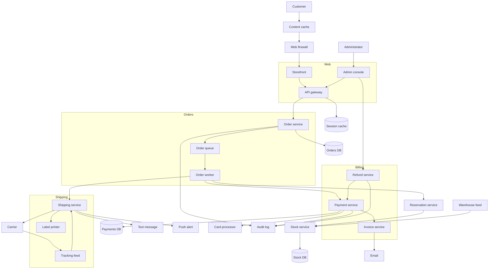

## Loan underwriting decisions

Expected VCS: 65 from 41 nodes and 48 edges.

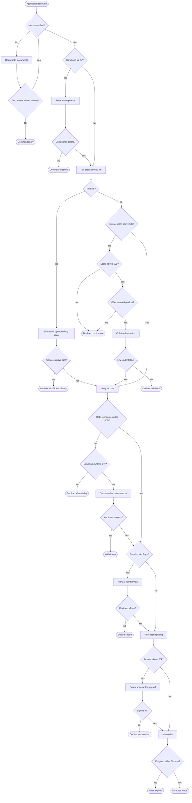

## Unreadable label

Both themes must report this white text on a white fill.

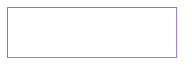

## Clean diagram after the failure

The reused node ID must inherit no styling from the preceding diagram.

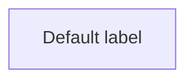

## Extended parser-family corpus

These intentionally poor styles and dense models exercise contrast auditing and summarisation guidance.
The companion fixed document preserves the same scenarios and facts.
Beta fences deliberately require Mermaid 11.17.2 or newer; they test parser support rather than older GitHub rendering.

### Legacy returns routing

Family detector: `flowchart`.

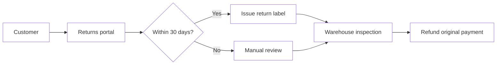

### Regional order routing

Family detector: `flowchart-elk`.

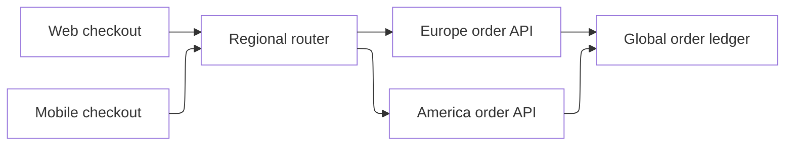

### Order domain classes

Family detector: `classDiagram`.

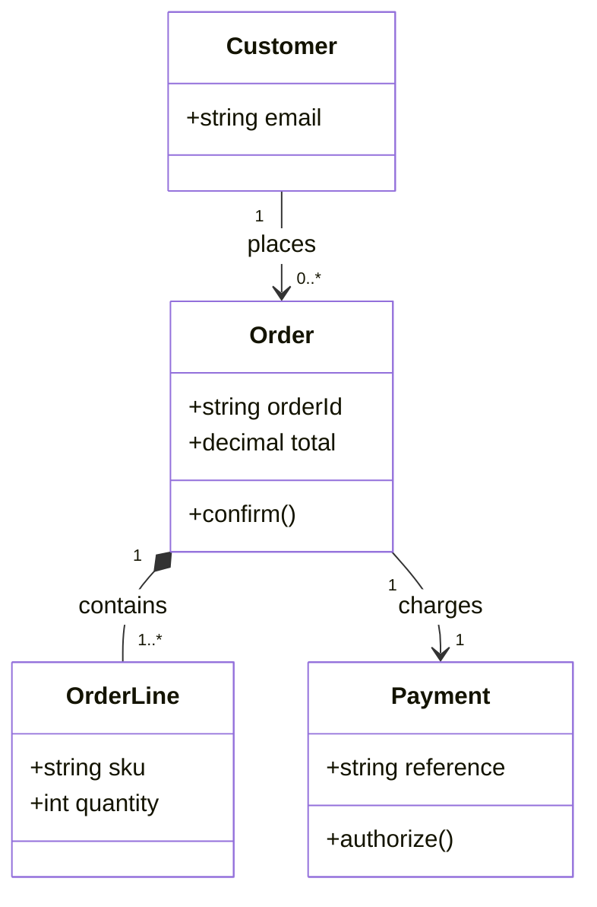

### Legacy inventory interfaces

Family detector: `class`.

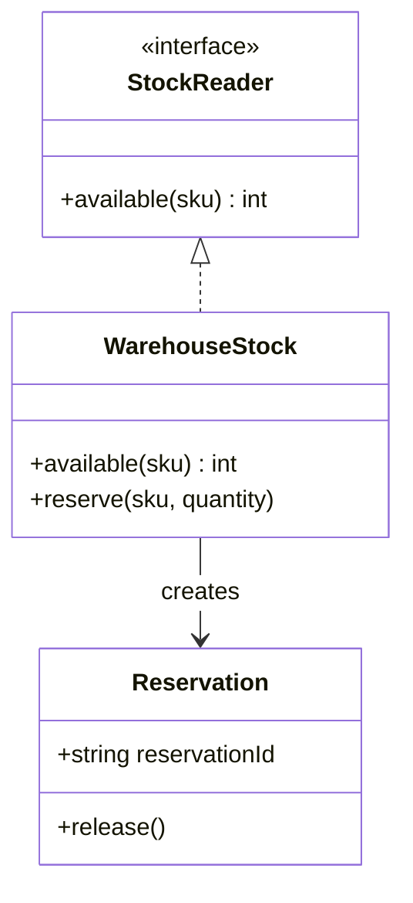

### Order storage relationships

Family detector: `er`.

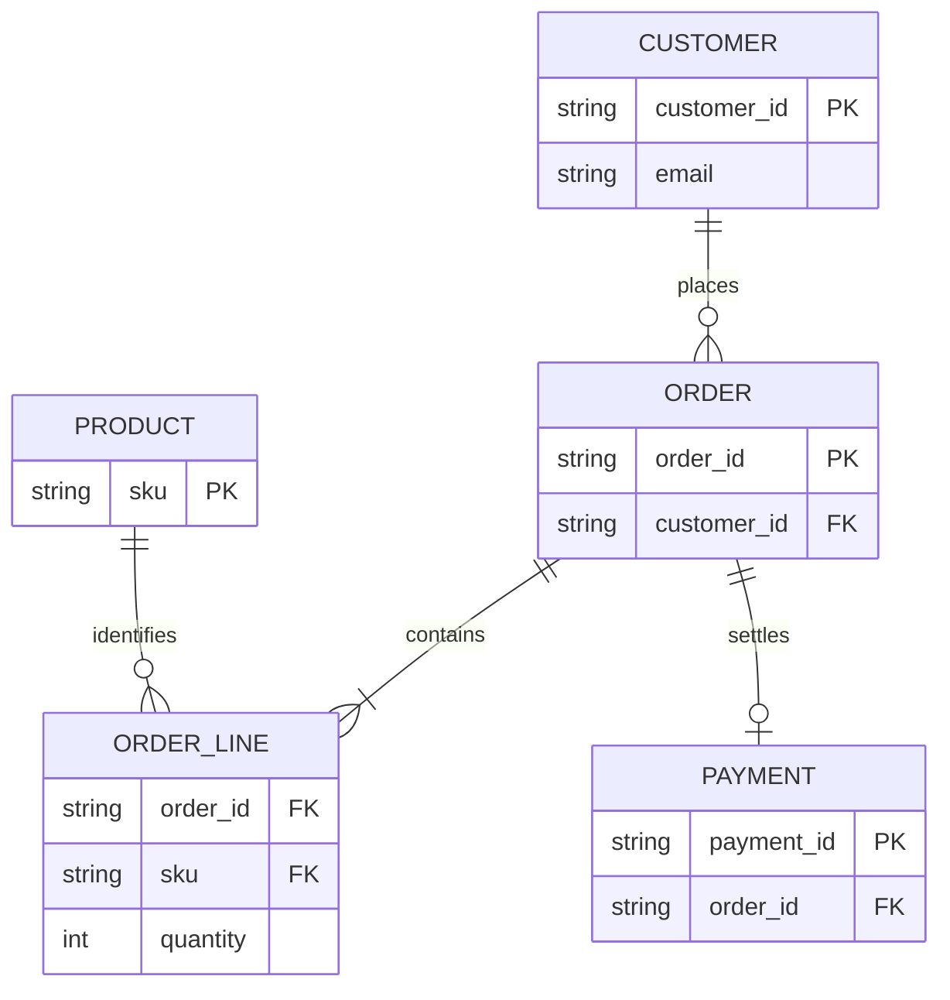

### Checkout authorization sequence

Family detector: `sequence`.

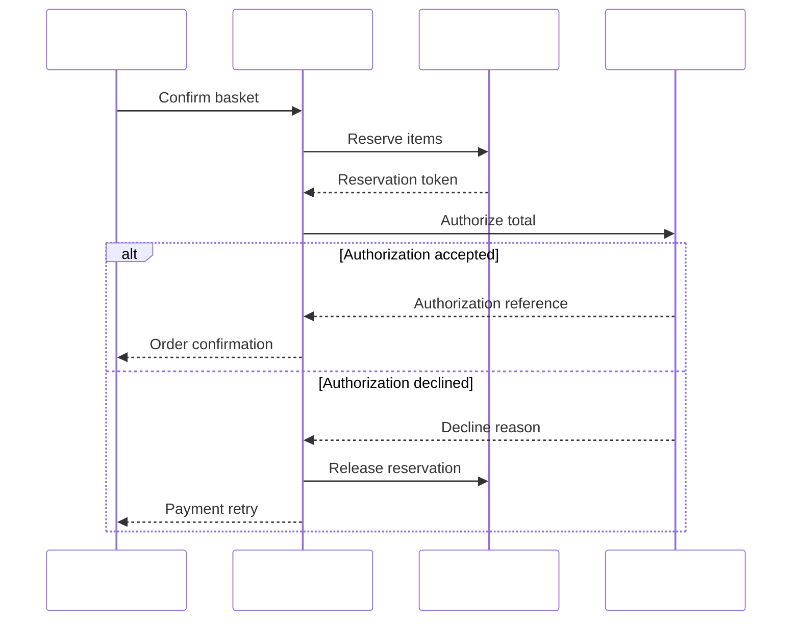

### Legacy payment lifecycle

Family detector: `stateDiagram`.

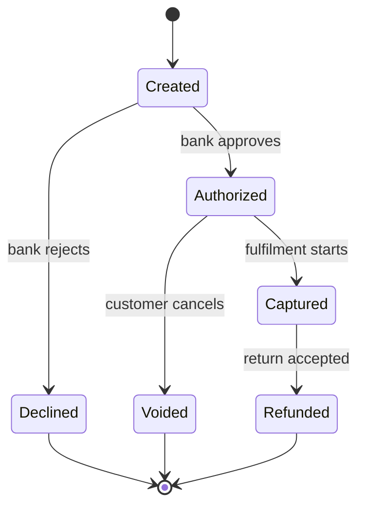

### Reservation lifecycle

Family detector: `state`.

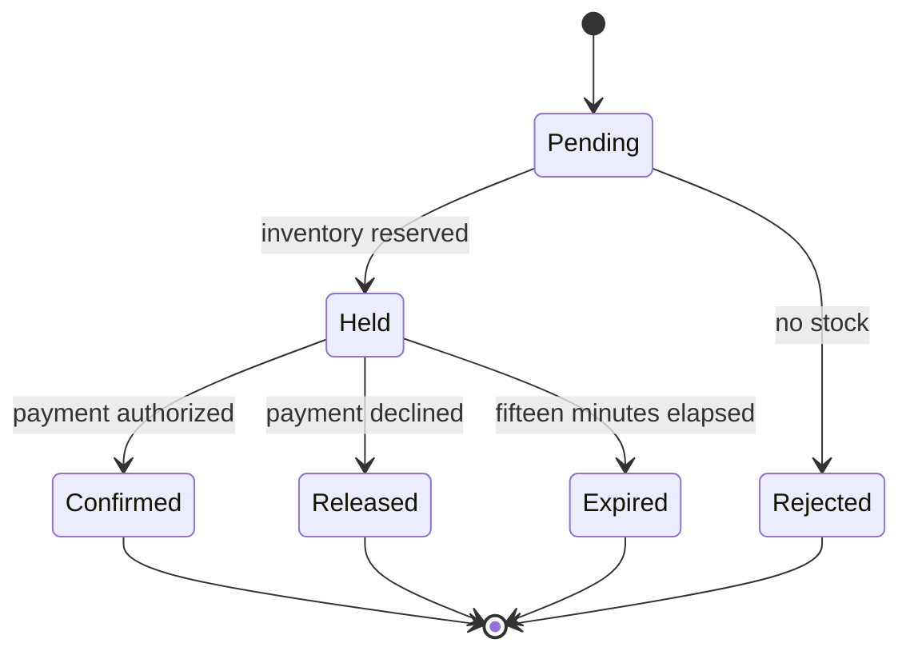

### Returns responsibility lanes

Family detector: `swimlane`.

```mermaid
---
config: {"themeVariables":{"primaryTextColor":"#fff","primaryColor":"#fff","mainBkg":"#fff"}}
---
swimlane-beta LR
  subgraph Customer
    Request[Request return] --> Pack[Pack parcel]
  end
  subgraph Support
    Approve[Approve eligibility]
    Notify[Notify refund]
  end
  subgraph Warehouse
    Inspect[Inspect parcel] --> Restock[Restock items]
  end
  Request --> Approve
  Approve --> Pack
  Pack --> Inspect
  Restock --> Notify
```

### Fulfilment readiness checklist

Family detector: `mindmap`.

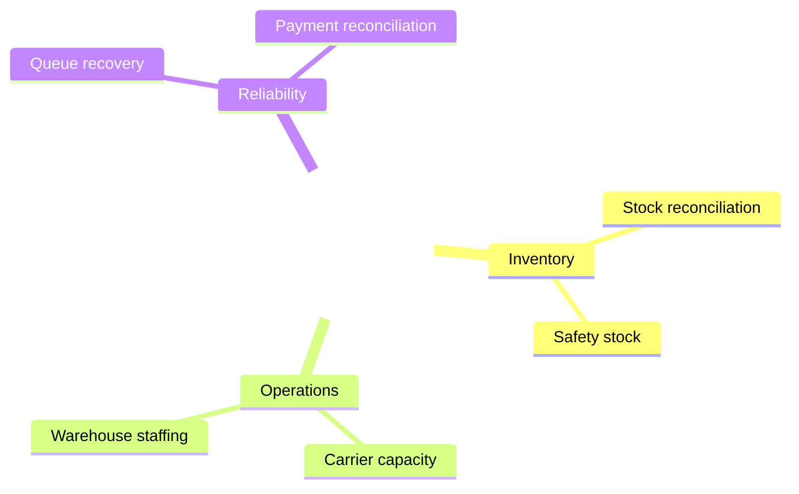

### Checkout infrastructure

Family detector: `architecture`.

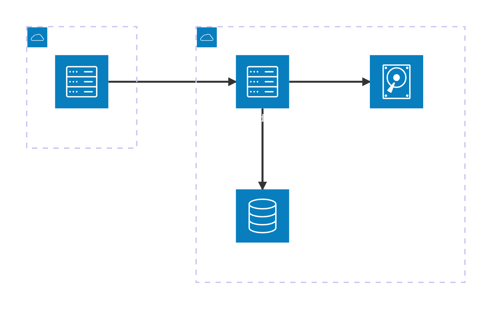

### Checkout system context

Family detector: `c4`.

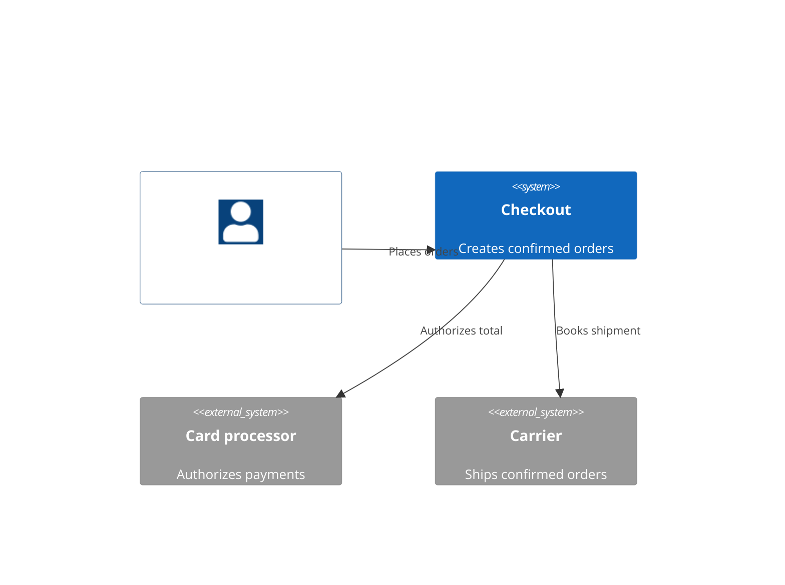

### Checkout release work

Family detector: `kanban`.

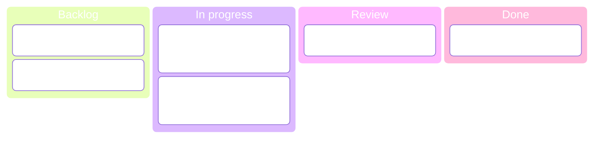

### Warehouse rollout schedule

Family detector: `gantt`.

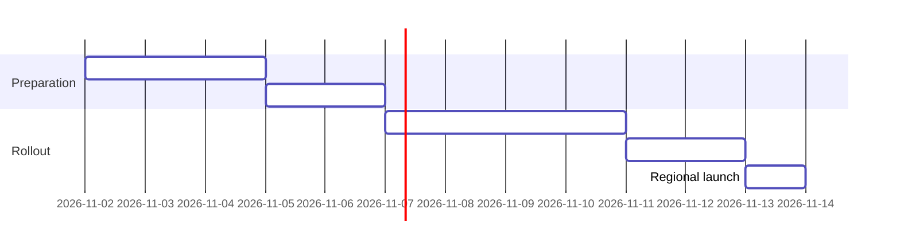

### Parser compatibility identity

Family detector: `info`.

```mermaid
---
config: {"themeVariables":{"textColor":"#fff"}}
---
info
```

### Refund reason distribution

Family detector: `pie`.

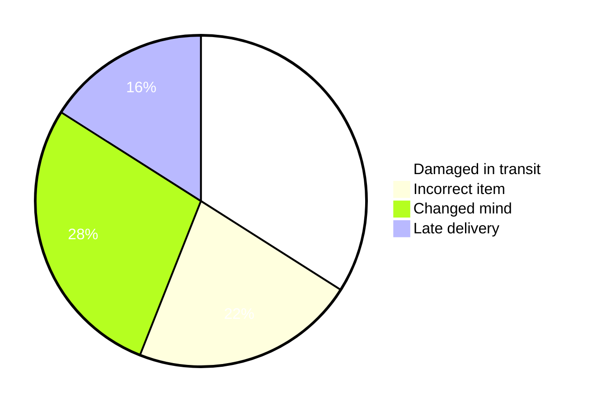

### Reservation safety requirements

Family detector: `requirement`.

```mermaid
---
config: {"themeVariables":{"requirementTextColor":"#fff","requirementBackground":"#fff"}}
---
requirementDiagram
  requirement reservation_expiry {
    id: R1
    text: Unpaid reservations expire within fifteen minutes
    risk: high
    verifymethod: test
  }
  requirement refund_audit {
    id: R2
    text: Every refund records an audit reference
    risk: medium
    verifymethod: inspection
  }
  element checkout_service {
    type: service
    docref: "checkout-contract"
  }
  element expiry_worker {
    type: worker
    docref: "reservation-contract"
  }
  checkout_service - satisfies -> refund_audit
  expiry_worker - satisfies -> reservation_expiry
```

### Checkout migration milestones

Family detector: `timeline`.

```mermaid
---
config: {"themeVariables":{"cScaleLabel1":"#fff","cScale1":"#fff"}}
---
timeline
  section Foundation
    2026-01 : Publish payment contract : Add reservation tracing
    2026-02 : Deploy idempotent authorization
  section Expansion
    2026-03 : Pilot regional fulfilment
    2026-04 : Enable refund reconciliation : Retire batch settlement
```

### Payment hotfix release history

Family detector: `gitGraph`.

```mermaid
---
config: {"themeVariables":{"gitBranchLabel0":"#fff","git0":"#fff"}}
---
gitGraph
  commit id: "Baseline"
  branch feature
  checkout feature
  commit id: "Idempotency"
  commit id: "Retry tests"
  checkout main
  branch hotfix
  checkout hotfix
  commit id: "Bank timeout"
  checkout main
  merge hotfix tag: "v2.1.1"
  merge feature tag: "v2.2.0"
```

### Buyer returns journey

Family detector: `journey`.

```mermaid
---
config: {"themeVariables":{"textColor":"#fff"}}
---
journey
  section Request
    Find order: 5: Buyer
    Explain issue: 3: Buyer
    Approve return: 4: Support
  section Fulfilment
    Print label: 4: Buyer
    Inspect parcel: 3: Warehouse
    Confirm refund: 5: Support
```

### Checkout improvement prioritisation

Family detector: `quadrantChart`.

```mermaid
---
config: {"themeVariables":{"quadrant1TextFill":"#fff","quadrant1Fill":"#fff"}}
---
quadrantChart
  x-axis Low effort --> High effort
  y-axis Low value --> High value
  quadrant-1 Strategic investments
  quadrant-2 Quick wins
  quadrant-3 Defer
  quadrant-4 Simplify first
  Retry observability: [0.22,0.82]
  Regional routing: [0.78,0.86]
  Receipt branding: [0.18,0.24]
  Legacy export: [0.76,0.32]
```

### Order disposition volumes

Family detector: `sankey`.

```mermaid
---
config: {"themeVariables":{"textColor":"#fff","mainBkg":"#fff"}}
---
sankey-beta

Placed,Payment accepted,920
Placed,Payment declined,80
Payment accepted,Shipped,870
Payment accepted,Cancelled,50
Shipped,Delivered,830
Shipped,Returned,40
```

### Order event envelope fields

Family detector: `packet`.

```mermaid
---
config: {"themeVariables":{"packet":{"labelColor":"#fff","blockFillColor":"#fff"}}}
---
packet-beta
  0-7: "Version"
  8-15: "Event type"
  16-31: "Payload length"
  32-63: "Order identifier"
  64-95: "Idempotency token"
```

### Weekly order throughput

Family detector: `xychart`.

```mermaid
---
config: {"themeVariables":{"xyChart":{"xAxisLabelColor":"#fff","backgroundColor":"#fff"}}}
---
xychart-beta
  x-axis [Mon,Tue,Wed,Thu,Fri]
  y-axis "Confirmed orders" 0 --> 500
  bar [280,310,350,420,390]
  line [260,300,340,400,380]
```

### Order worker stages

Family detector: `block`.

```mermaid
---
config: {"themeVariables":{"textColor":"#fff","mainBkg":"#fff"}}
---
block-beta
  columns 3
  input["Order queue"] worker["Order worker"] output["Shipment queue"]
  validation["Validate payload"] reservation["Reserve inventory"] payment["Authorize payment"]
  input --> worker
  worker --> output
  worker --> validation
  validation --> reservation
  reservation --> payment
```

### Order placement event model

Family detector: `eventmodeling`.

```mermaid
---
config: {"themeVariables":{"emUiFill":"#fff","textColor":"#fff"}}
---
eventmodeling
  tf 01 ui Basket
  tf 02 cmd PlaceOrder
  tf 03 evt OrderPlaced
  tf 04 rmo OrderSummary
  tf 05 ui Confirmation ->> 04
  tf 06 cmd ReserveStock ->> 03
  tf 07 evt StockReserved
```

### Checkout repository ownership

Family detector: `treeView`.

```mermaid
---
config: {"themeVariables":{"treeView":{"labelColor":"#fff"}}}
---
treeView-beta
checkout
  api
    orders.ts
    refunds.ts
  workers
    reservations.ts
    reconciliation.ts
  contracts
    order-event.json
```

### Fulfilment capability comparison

Family detector: `radar`.

```mermaid
---
config: {"themeVariables":{"radar":{"axisColor":"#fff"}}}
---
radar-beta
  axis speed["Speed"], reliability["Reliability"], coverage["Coverage"], cost["Cost"]
  curve current["Current"]{3,4,3,4}
  curve target["Target"]{4,5,5,3}
```

### Late shipment cause analysis

Family detector: `ishikawa`.

```mermaid
---
config: {"themeVariables":{"textColor":"#fff","mainBkg":"#fff"}}
---
ishikawa-beta
Late shipment
  Inventory
    Stale stock counts
    Delayed replenishment
  Operations
    Picking backlog
    Missing parcel labels
  Carrier
    Capacity limits
    Missed collection
```

### Monthly fulfilment costs

Family detector: `treemap`.

```mermaid
---
config: {"themeVariables":{"treemap":{"labelColor":"#fff","leafFillColor":"#fff"}}}
---
treemap-beta
"Fulfilment"
  "Warehouse"
    "Picking": 34
    "Packing": 16
  "Transport"
    "Domestic": 30
    "International": 20
```

### Order query builder grammar

Family detector: `railroad`.

```mermaid
---
config: {"railroad":{"terminalFill":"#fff","terminalTextColor":"#fff"}}
---
railroad-beta
query = sequence(terminal("orders"), optional(sequence(terminal("where"), nonterminal("predicate"))), optional(sequence(terminal("limit"), nonterminal("integer"))));
```

### Reservation command EBNF

Family detector: `railroadEbnf`.

```mermaid
---
config: {"railroad":{"terminalFill":"#fff","terminalTextColor":"#fff"}}
---
railroad-ebnf-beta
command = "reserve", identifier, "quantity", integer, [ "until", timestamp ];
```

### Order reference ABNF

Family detector: `railroadAbnf`.

```mermaid
---
config: {"railroad":{"terminalFill":"#fff","terminalTextColor":"#fff"}}
---
railroad-abnf-beta
reference = "ORD-" 4DIGIT "-" 6DIGIT;
DIGIT = "0" / "1" / "2" / "3" / "4" / "5" / "6" / "7" / "8" / "9";
```

### Checkout route PEG

Family detector: `railroadPeg`.

```mermaid
---
config: {"railroad":{"terminalFill":"#fff","terminalTextColor":"#fff"}}
---
railroad-peg-beta
route <- "/orders/" identifier ("/refunds" / "/shipments")?;
identifier <- "standard" / "priority";
```

### Buyer channel overlap

Family detector: `venn`.

```mermaid
---
config: {"themeVariables":{"vennSetTextColor":"#fff","venn1":"#fff","venn2":"#fff","venn3":"#fff"}}
---
venn-beta
set Mobile: 70
set Web: 65
set Store: 40
union Mobile,Web: 25
union Mobile,Store: 12
union Web,Store: 10
union Mobile,Web,Store: 5
```

### Checkout capability evolution

Family detector: `wardley`.

```mermaid
---
config: {"themeVariables":{"wardley":{"componentLabelColor":"#fff","backgroundColor":"#fff"}}}
---
wardley-beta
component Checkout [0.85, 0.45]
component Payments [0.65, 0.75]
component Inventory [0.55, 0.60]
component Compute [0.25, 0.95]
Checkout -> Payments
Checkout -> Inventory
Payments -> Compute
Inventory -> Compute
```

### Checkout operational decision contexts

Family detector: `cynefin`.

```mermaid
---
config: {"themeVariables":{"cynefin":{"complexBg":"#fff","labelColor":"#fff","textColor":"#fff"}}}
---
cynefin-beta
complex
"Experiment with fraud signals"
complicated
"Analyse settlement mismatch"
clear
"Apply documented refund policy"
chaotic
"Contain payment outage"
confusion
"Triage unknown decline spike"
complex --> complicated: "Evidence stabilises"
chaotic --> clear: "Runbook restores service"
```

### Checkout ledger storage detail

Family detector: `er`.

```mermaid
---
config: {}
---
erDiagram
  CUSTOMER ||--o{ ADDRESS : has
  CUSTOMER ||--o{ CART : opens
  CART ||--|{ CART_LINE : contains
  PRODUCT ||--o{ CART_LINE : selected
  PRODUCT ||--o{ INVENTORY : stocked
  CART_LINE ||--o{ RESERVATION : holds
  INVENTORY ||--o{ RESERVATION : allocates
  CUSTOMER ||--o{ ORDER : places
  ADDRESS ||--o{ ORDER : ships_to
  ORDER ||--|{ ORDER_LINE : contains
  PRODUCT ||--o{ ORDER_LINE : identifies
  ORDER ||--o{ PAYMENT : records
  PAYMENT ||--|{ PAYMENT_ATTEMPT : attempts
  PAYMENT ||--o{ REFUND : refunds
  ORDER ||--o{ SHIPMENT : dispatches
  SHIPMENT ||--|{ SHIPMENT_ITEM : contains
  ORDER_LINE ||--o{ SHIPMENT_ITEM : fulfils
  ORDER_LINE ||--o{ RETURN : returned
  RETURN ||--o| REFUND : settles
  ORDER ||--o{ AUDIT_EVENT : audits
  CUSTOMER {
    string customer_id PK
    string email UK
    string full_name
    string phone
    string loyalty_tier
    string country
    boolean marketing_opt_in
    datetime created_at
    datetime updated_at
    string status
  }
  ADDRESS {
    string address_id PK
    string customer_id FK
    string recipient
    string street
    string city
    string region
    string postal_code
    string country
    boolean default_shipping
    datetime verified_at
  }
  CART {
    string cart_id PK
    string customer_id FK
    string currency
    decimal subtotal
    decimal tax_total
    decimal shipping_total
    string promotion_code
    string channel
    datetime expires_at
    string status
  }
  CART_LINE {
    string cart_line_id PK
    string cart_id FK
    string sku FK
    int quantity
    decimal unit_price
    decimal tax_amount
    decimal discount_amount
    string fulfilment_region
    datetime added_at
    datetime updated_at
  }
  PRODUCT {
    string sku PK
    string product_name
    string category
    string brand
    decimal list_price
    string currency
    int weight_grams
    boolean hazardous
    string lifecycle_status
    datetime updated_at
  }
  INVENTORY {
    string inventory_id PK
    string sku FK
    string warehouse_code
    int on_hand
    int reserved
    int available
    int reorder_point
    string stock_status
    datetime counted_at
    datetime updated_at
  }
  RESERVATION {
    string reservation_id PK
    string cart_line_id FK
    string inventory_id FK
    int quantity
    string owner_token
    string idempotency_key UK
    datetime created_at
    datetime expires_at
    datetime released_at
    string status
  }
  ORDER {
    string order_id PK
    string customer_id FK
    string address_id FK
    string source_cart_id
    string currency
    decimal grand_total
    string channel
    string status
    datetime placed_at
    datetime confirmed_at
  }
  ORDER_LINE {
    string order_line_id PK
    string order_id FK
    string sku FK
    int quantity
    decimal unit_price
    decimal tax_amount
    decimal discount_amount
    string fulfilment_status
    datetime promised_at
    datetime fulfilled_at
  }
  PAYMENT {
    string payment_id PK
    string order_id FK
    string provider_reference UK
    string currency
    decimal authorized_amount
    decimal captured_amount
    decimal refunded_amount
    string status
    datetime authorized_at
    datetime captured_at
  }
  PAYMENT_ATTEMPT {
    string attempt_id PK
    string payment_id FK
    string idempotency_key UK
    string provider_code
    int attempt_number
    decimal requested_amount
    string response_code
    string outcome
    datetime started_at
    datetime completed_at
  }
  REFUND {
    string refund_id PK
    string payment_id FK
    string return_id FK
    string provider_reference UK
    decimal amount
    string currency
    string reason
    string status
    datetime requested_at
    datetime completed_at
  }
  SHIPMENT {
    string shipment_id PK
    string order_id FK
    string carrier_code
    string service_level
    string tracking_number UK
    string warehouse_code
    string status
    datetime booked_at
    datetime dispatched_at
    datetime delivered_at
  }
  SHIPMENT_ITEM {
    string shipment_item_id PK
    string shipment_id FK
    string order_line_id FK
    int quantity
    string parcel_reference
    int parcel_weight_grams
    string packaging_type
    string scan_status
    datetime packed_at
    datetime scanned_at
  }
  RETURN {
    string return_id PK
    string order_line_id FK
    int quantity
    string reason
    string inspection_outcome
    string destination_warehouse
    string status
    datetime requested_at
    datetime received_at
    datetime inspected_at
  }
  AUDIT_EVENT {
    string audit_event_id PK
    string order_id FK
    string actor_id
    string action
    string correlation_id
    string source_system
    string previous_status
    string next_status
    datetime occurred_at
    datetime recorded_at
  }
```

### Purchase delivery return and refund lifecycle

Family detector: `sequence`.

```mermaid
---
config: {}
---
sequenceDiagram
  participant Buyer
  participant Storefront
  participant Orders
  participant Inventory
  participant Payments
  participant Warehouse
  participant Carrier
  participant Ledger
  participant Support
  Note over Buyer,Orders: Basket validation
  Buyer->>Storefront: Open basket
  Storefront-->>Buyer: Basket items and totals
  Storefront->>Orders: Validate requested products
  Orders-->>Storefront: Validated basket
  Storefront->>Orders: Calculate tax and delivery
  Orders-->>Storefront: Quoted total
  Orders->>Inventory: Read stock positions
  Inventory-->>Orders: Regional stock positions
  Storefront->>Buyer: Request delivery address
  Buyer-->>Storefront: Confirmed delivery address
  Storefront->>Orders: Validate promotion code
  Orders-->>Storefront: Promotion eligibility
  Buyer->>Storefront: Accept quoted basket
  Storefront-->>Buyer: Basket acceptance recorded
  Note over Buyer,Orders: Inventory reservation
  Storefront->>Orders: Submit checkout intent
  Orders-->>Storefront: Checkout identifier
  Orders->>Inventory: Create expiring stock holds
  Inventory-->>Orders: Reservation tokens
  Inventory->>Warehouse: Check picking capacity
  Warehouse-->>Inventory: Capacity slot
  Orders->>Ledger: Record reservation intent
  Ledger-->>Orders: Audit receipt
  Orders->>Inventory: Verify reserved quantities
  Inventory-->>Orders: Quantity verification
  Orders->>Storefront: Publish reserved basket
  Storefront-->>Orders: Reserved basket acknowledged
  Storefront->>Buyer: Present reserved total
  Buyer-->>Storefront: Payment choice
  Note over Buyer,Orders: Payment authorization
  Storefront->>Payments: Tokenize selected payment
  Payments-->>Storefront: Payment token
  Orders->>Payments: Authorize confirmed amount
  Payments-->>Orders: Authorization reference
  Payments->>Ledger: Record provider response
  Ledger-->>Payments: Authorization audit receipt
  Orders->>Payments: Confirm authorization status
  Payments-->>Orders: Authorized status
  Orders->>Inventory: Attach authorization reference
  Inventory-->>Orders: Reservation linkage
  Orders->>Ledger: Record order confirmation
  Ledger-->>Orders: Confirmation audit receipt
  Storefront->>Buyer: Display confirmed order
  Buyer-->>Storefront: Confirmation acknowledged
  Note over Buyer,Orders: Warehouse fulfilment
  Orders->>Warehouse: Release picking request
  Warehouse-->>Orders: Picking batch identifier
  Warehouse->>Inventory: Read reserved locations
  Inventory-->>Warehouse: Picking locations
  Warehouse->>Inventory: Confirm picked quantities
  Inventory-->>Warehouse: Pick reconciliation
  Warehouse->>Orders: Report substitution check
  Orders-->>Warehouse: Substitution decision
  Warehouse->>Inventory: Consume confirmed reservation
  Inventory-->>Warehouse: Stock movement receipt
  Warehouse->>Ledger: Record packing evidence
  Ledger-->>Warehouse: Packing audit receipt
  Warehouse->>Orders: Report packed parcels
  Orders-->>Warehouse: Shipment request
  Note over Buyer,Orders: Carrier dispatch
  Orders->>Carrier: Quote selected service
  Carrier-->>Orders: Carrier quote
  Orders->>Carrier: Book packed parcels
  Carrier-->>Orders: Tracking identifiers
  Carrier->>Warehouse: Issue printable labels
  Warehouse-->>Carrier: Label application confirmation
  Warehouse->>Carrier: Confirm collection readiness
  Carrier-->>Warehouse: Collection booking
  Carrier->>Orders: Report parcel collection
  Orders-->>Carrier: Collection acknowledged
  Orders->>Payments: Capture authorized amount
  Payments-->>Orders: Capture reference
  Orders->>Ledger: Record dispatch and capture
  Ledger-->>Orders: Dispatch audit receipt
  Note over Buyer,Orders: Delivery confirmation
  Orders->>Carrier: Read tracking progress
  Carrier-->>Orders: In-transit scan
  Storefront->>Orders: Read buyer order status
  Orders-->>Storefront: Tracking summary
  Buyer->>Storefront: Open shipment tracker
  Storefront-->>Buyer: Shipment tracker displayed
  Carrier->>Orders: Report delivery attempt
  Orders-->>Carrier: Attempt acknowledged
  Carrier->>Orders: Report delivered parcel
  Orders-->>Carrier: Delivery acknowledged
  Orders->>Ledger: Record delivery evidence
  Ledger-->>Orders: Delivery audit receipt
  Storefront->>Buyer: Present delivery confirmation
  Buyer-->>Storefront: Delivery confirmation acknowledged
  Note over Buyer,Orders: Return inspection
  Buyer->>Support: Request damaged-item return
  Support-->>Buyer: Return case identifier
  Support->>Orders: Check return eligibility
  Orders-->>Support: Eligible order lines
  Support->>Carrier: Book return collection
  Carrier-->>Support: Return tracking identifier
  Carrier->>Warehouse: Deliver returned parcel
  Warehouse-->>Carrier: Return receipt
  Warehouse->>Orders: Report item inspection
  Orders-->>Warehouse: Inspection decision
  Warehouse->>Inventory: Restock accepted quantities
  Inventory-->>Warehouse: Restock movement receipt
  Support->>Buyer: Confirm accepted return
  Buyer-->>Support: Return acceptance acknowledged
  Note over Buyer,Orders: Refund reconciliation
  Support->>Orders: Approve inspected refund
  Orders-->>Support: Refund request identifier
  Orders->>Payments: Refund original captured payment
  Payments-->>Orders: Provider refund reference
  Payments->>Ledger: Record refund provider response
  Ledger-->>Payments: Refund audit receipt
  Orders->>Payments: Verify refund settlement
  Payments-->>Orders: Settled refund status
  Orders->>Ledger: Close refund reconciliation
  Ledger-->>Orders: Reconciliation receipt
  Storefront->>Buyer: Present refund confirmation
  Buyer-->>Storefront: Refund confirmation acknowledged
  Support->>Orders: Close return case
  Orders-->>Support: Closed return status
```
