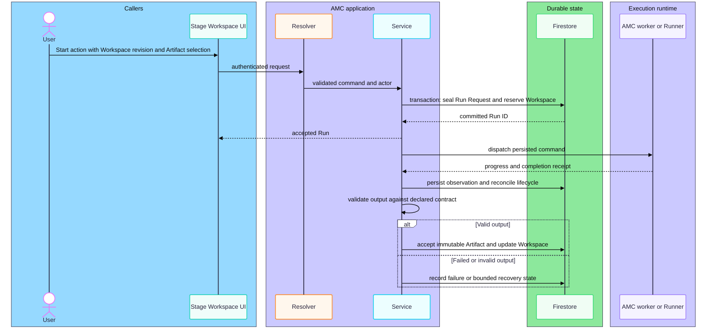
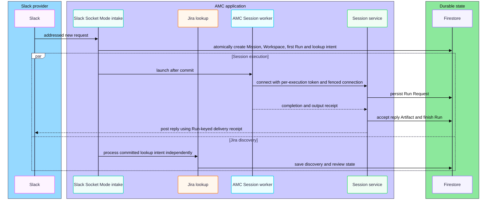

# Sequence contrast across coloured participant groups

These intentionally failing sequences pin a light palette while messages cross coloured participant boxes and the page canvas.
Their connecting lines and arrows must remain measurable in both viewer themes.

## Start and reconcile a Stage Run

## Parallel intake and Session turns

