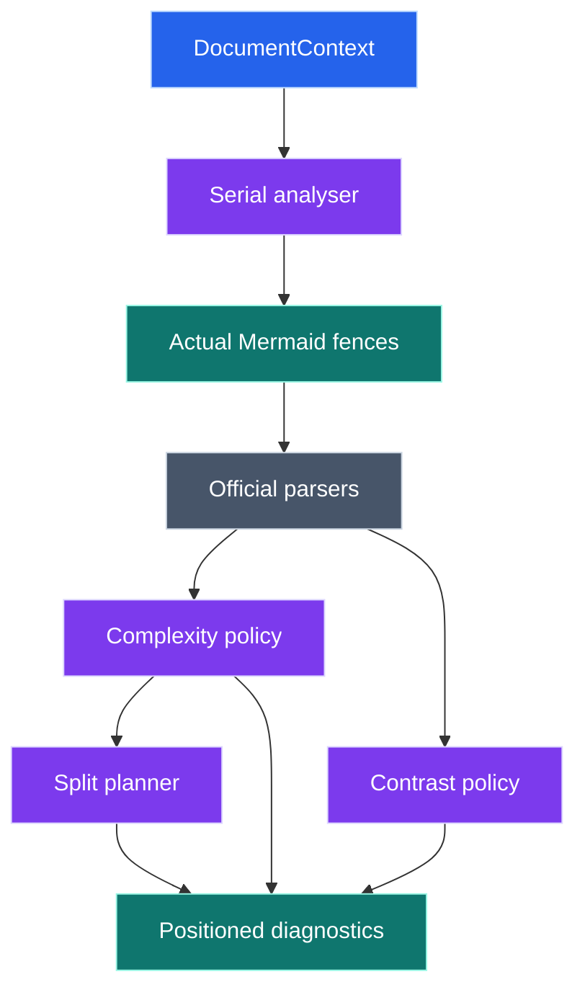
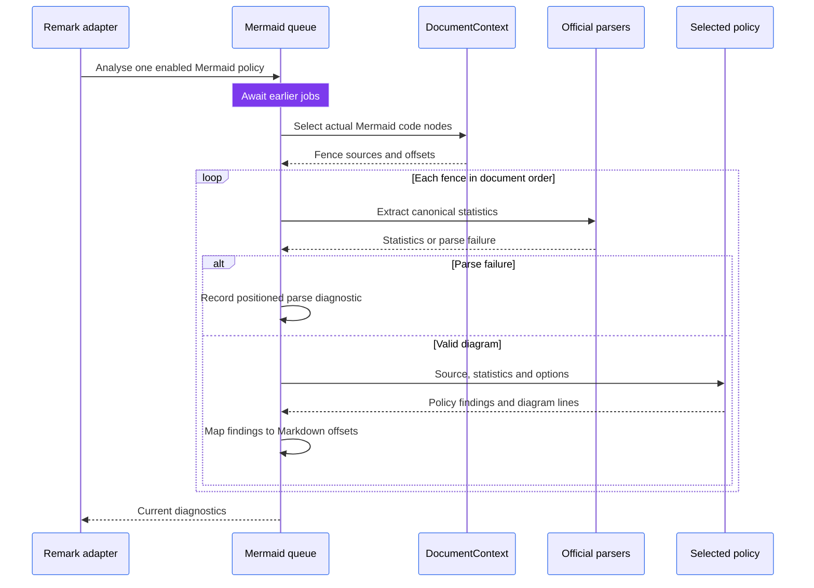
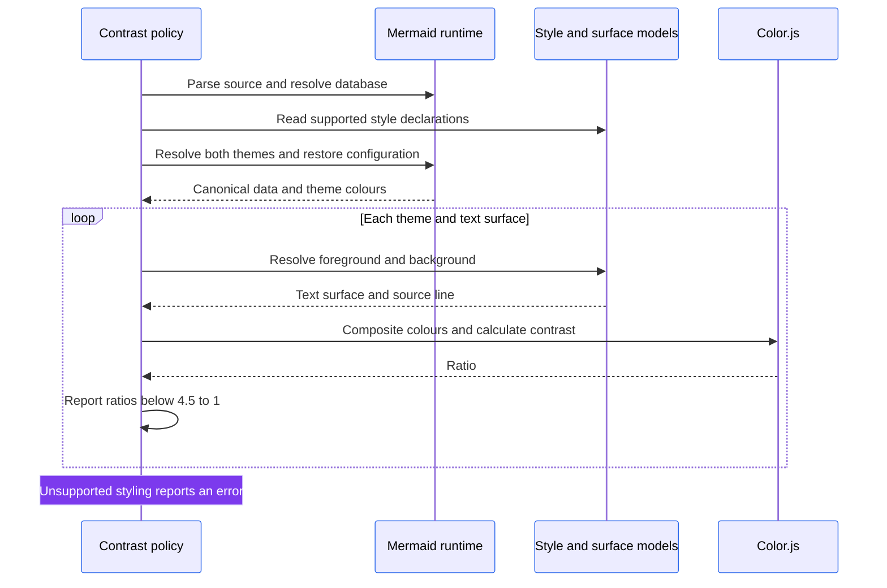

# Mermaid analysis architecture

This subsystem checks actual Mermaid code fences for visual complexity and readable text in light and dark themes.
It uses official parser models and reports positioned errors through the custom remark plugin.
It does not edit diagram source automatically.

Start with the [package architecture](../../ARCHITECTURE.md) for the document and event models.
Read [contributing](../../CONTRIBUTING.md) to add a policy.
The [split planner](splitting/README.md) documents its own architecture and contracts; this page treats it as one component.

## Architecture

Where do shared parsing and policy-specific calculations meet?

The process-local Promise queue in [`analyze.ts`](analyze.ts) protects Mermaid's mutable parser and theme singletons.
[`markdown.ts`](markdown.ts) visits code nodes in the actual host tree and maps diagram-relative lines to absolute Markdown offsets.
It does not infer diagrams from Markdown-looking text inside other code blocks.

| Folder or module | Responsibility |
| --- | --- |
| [`analyze.ts`](analyze.ts) | Serial jobs, enabled-policy dispatch and fence-level failures |
| [`parsing/engine.ts`](parsing/engine.ts) | Mermaid lifecycle, browser shim, type detection and bounded caches |
| [`parsing/statistics.ts`](parsing/statistics.ts) | Official grammar/database adapters and common statistics |
| [`parsing/graph.ts`](parsing/graph.ts) | Canonical graph projections for supported diagram families |
| [`styling/declarations.ts`](styling/declarations.ts) | Official parser callbacks, supported declarations and source alignment |
| [`contrast/policy.ts`](contrast/policy.ts) | Resolve text surfaces, audit both themes and report unauditable styling |
| [`contrast/colors.ts`](contrast/colors.ts) | Color.js conversion, compositing and WCAG ratios |
| [`complexity/metrics.ts`](complexity/metrics.ts) | Visual complexity formula, presets and targets |
| [`complexity/policy.ts`](complexity/policy.ts) | Complexity errors and verified recommendation formatting |
| [`splitting/`](splitting/README.md) | Overview/detail recommendations and independent verification |

The Happy DOM repair must run before Mermaid loads because its sanitiser captures browser getters during initialisation.
Family adapters read official databases or typed Langium models instead of approximating syntax with regular expressions.
Parser-result caches are bounded and return cloned values; there is no source-only diagnostic cache.

## Fence processing sequence

How are multiple diagrams checked without sharing authored styles?

The adapter runs the contrast policy and then complexity as separate queue jobs when both are enabled.
Each job visits every selected fence; the statistics cache can reuse the same diagram's canonical result.
Parse failures skip policy evaluation for that fence and become errors attributed to the selected policy.
Disabled policies do not evaluate unrelated options or run their analysis.

## Contrast sequence

How do parser facts become a readable-colour decision?

Surface adapters account for supported node styles, text backgrounds, translucent fills and the configured page canvas.
Sequence diagrams have an ordered message model for participant groups, frames, notes and message backgrounds.
Custom `themeCSS`, unsupported rendering modes and unmodelled surfaces report unauditable errors rather than guessed contrast.
Theme transactions restore Mermaid configuration between theme resolutions.

## Complexity and recommendations

The score combines nodes, edges, rows, containers and depth according to the selected preset.
The complexity policy calls [split planning](splitting/README.md) only above the acceptable score.
A recommendation can contain verified diagram sources, a list or matrix alternative, or a refusal with useful limits.
Sequence diagrams remain lintable but are not split because a graph projection would discard message order.

## Verification

Run the [package checks](../../README.md#validate-the-package) and inspect the [multiple-diagram corpus](../../examples/multiple-diagrams.md).
Parser, contrast and queue changes need behaviour coverage for multiple fences, source positions, malformed diagrams and style isolation.
Use the [revised corpus](../../examples/multiple-diagrams-fixed.md) to verify complete-document behaviour.
