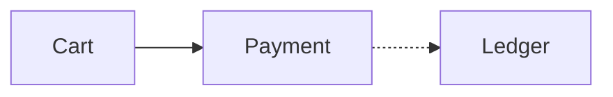
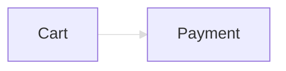
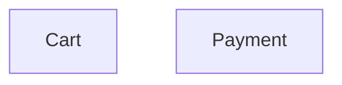
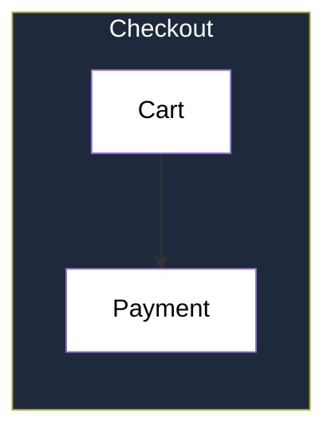
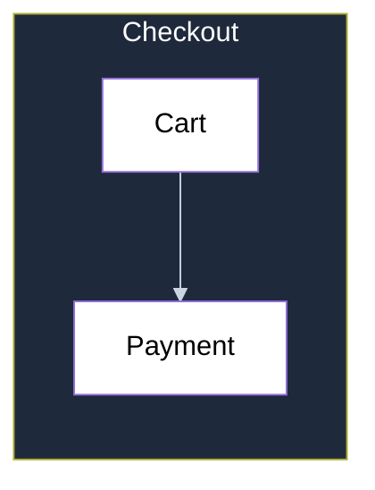
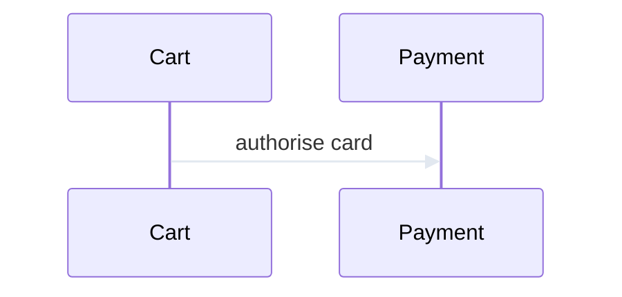

# Connector contrast

Each section names whether its connectors pass or fail 3:1.

## Passing: theme line colours

## Failing: pale link style

## Passing: invisible layout link

## Failing: default lines inside a dark cluster

## Passing: light lines inside a dark cluster

## Failing: pale sequence messages

