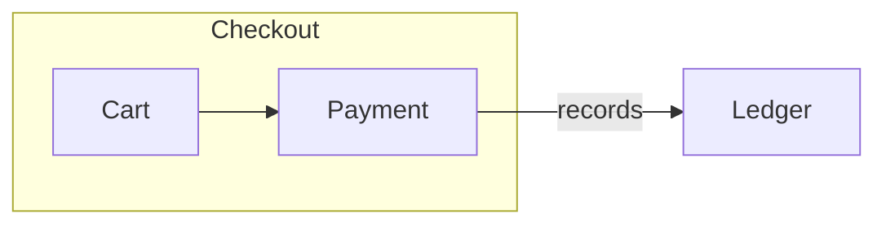
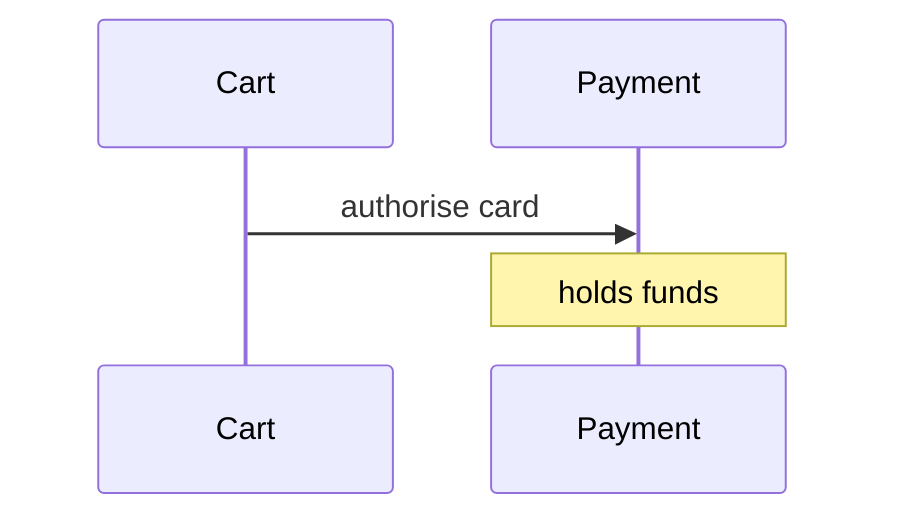
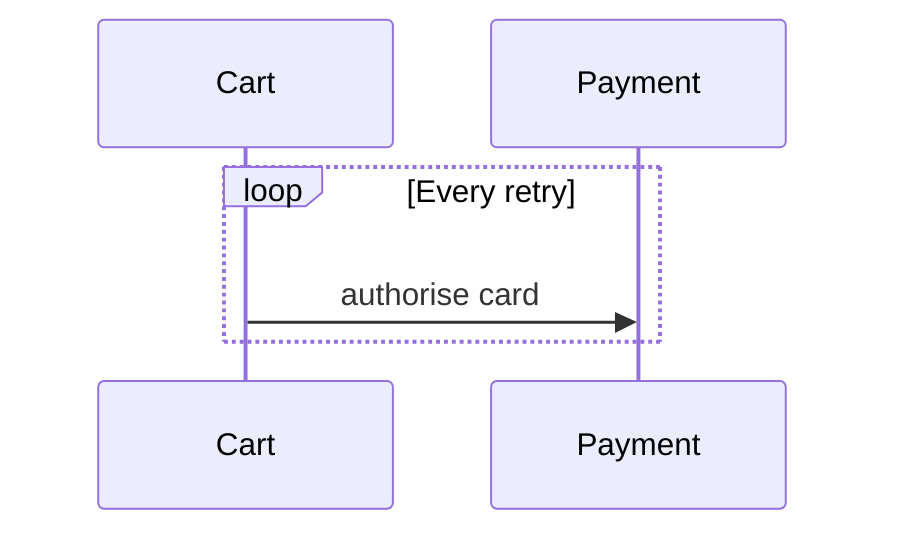
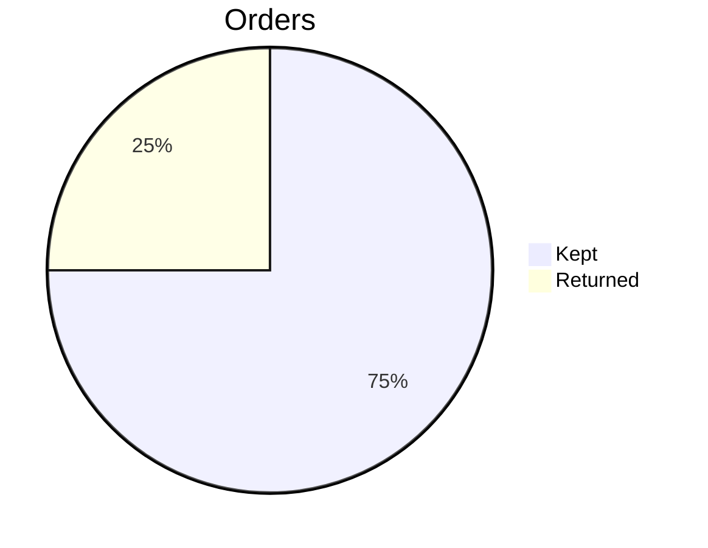

# Material for MkDocs viewer

These diagrams are measured with the default indigo palette in its light and slate modes.
Each section names whether it passes or fails there.

## Passing: a flowchart with a cluster

## Passing: sequence messages and notes

## Failing: sequence frame labels in the accent colour

## Failing: a light pie on the dark palette

