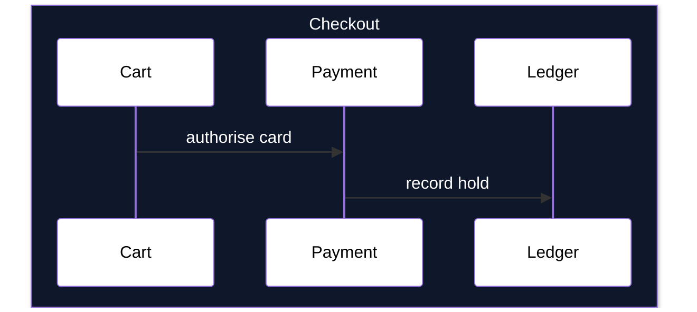
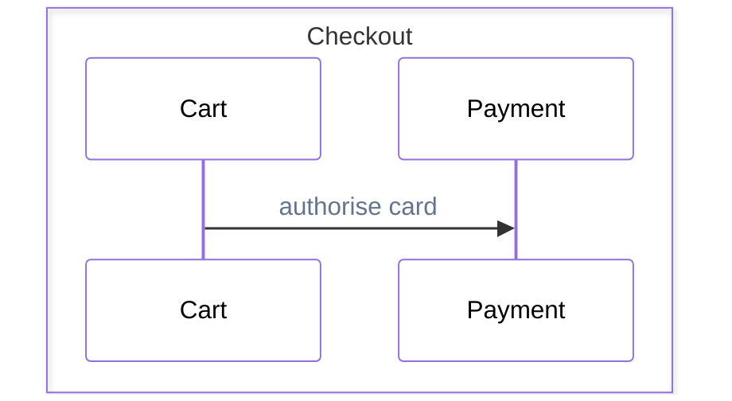
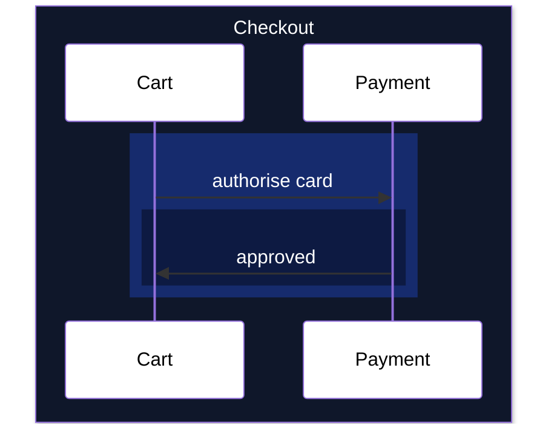
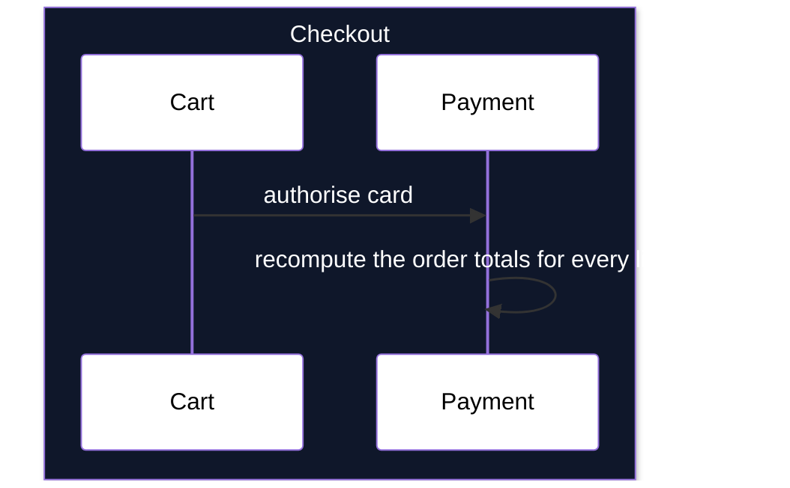

# Sequence participant groups

Each diagram pins light text so its backdrop decides the outcome.

## Opaque group

Messages between members of one dark group sit on the group fill.

## Transparent group

A transparent group shows the page, so its labels need page contrast.

## Nested rectangles

Translucent rects composite over the group fill in statement order.

## Self message on an edge participant

A self message label is centred on its lifeline, so on the last member it reaches the page.

