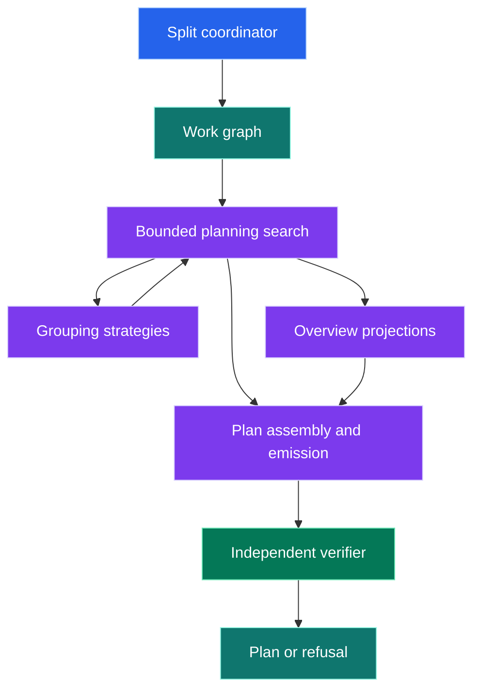
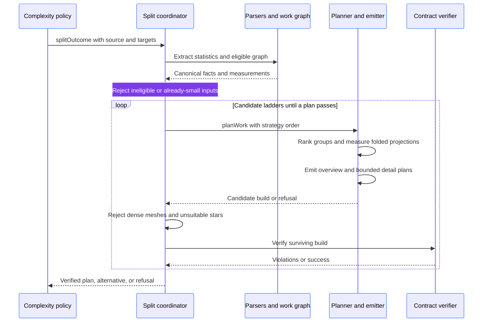
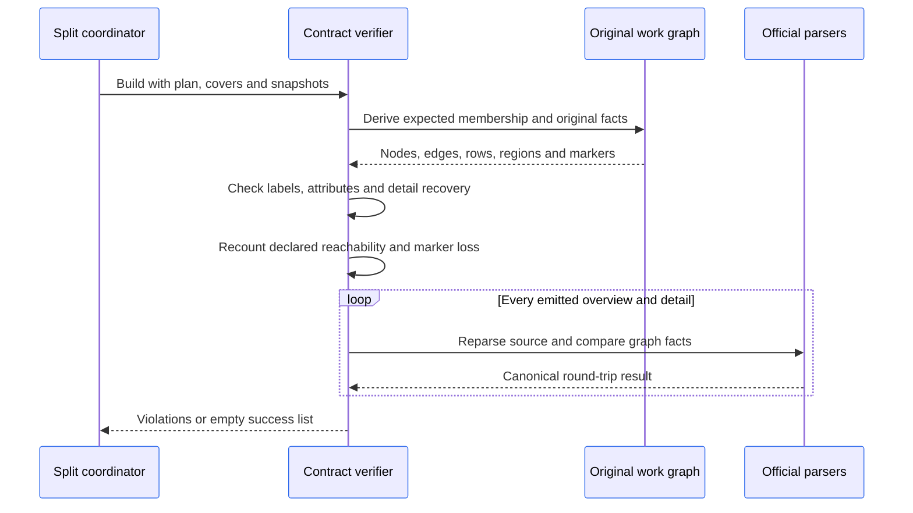

# Mermaid split-planning architecture

The planner recommends an overview and detail diagrams for a Mermaid diagram that exceeds its readability target.
It offers a plan only after independently verifying recoverable facts, emitted source and declared information loss.
It never replaces the authored Markdown or applies an automatic diagram edit.

Read the [Mermaid subsystem](../README.md) for parsing and policy dispatch and the [package architecture](../../../ARCHITECTURE.md) for shared models.

## Architecture

Which parts produce a candidate, and which parts verify it?

[`index.ts`](index.ts) owns family eligibility, graph/statistics agreement, mesh/star alternatives and final acceptance.
It receives Mermaid source and the complexity configuration from the calling policy.
It refuses unsupported families, concurrent state regions and sequence diagrams whose ordered semantics cannot be represented by this graph contract.

| Folder | Responsibility |
| --- | --- |
| [`graph/`](graph/model.ts) | Work graph, ordering, reachability, library adapters and ownership |
| [`planning/`](planning/search.ts) | Contracts, candidate checks, ranking, partitions and bounded search |
| [`strategies/`](strategies/regions.ts) | Author regions, entities, patterns, sibling leaves and communities |
| [`projection/`](projection/quotient.ts) | Folded relationships, overview shape, loss and measurements |
| [`labels/`](labels/groups.ts) | Pure text grammar, graph ranking, group names and stub context |
| [`presentation/`](presentation/assemble.ts) | Overview/detail assembly, Mermaid emission and list/matrix alternatives |
| [`validation/`](validation/contract.ts) | Independent membership, labels, recovery, loss and source checks |

## Planning sequence

How does one source reach an accepted plan or a refusal?

The search tries whole lanes before staged lanes, then relaxes structural protections only when earlier attempts fail.
Author regions are preferred where present.
Other strategies each preserve one of these structures:

- decision regions
- entity ownership
- chain stages
- twins
- sibling leaves
- connected communities

Ranking and identifier ordering are deterministic.
Details may split once more; `MAX_DEPTH = 2` bounds recursive planning.
The first candidate ladder passing structural eligibility and the independent contract is offered.

Dense meshes can produce an adjacency matrix; unsuitable leaf stars can produce a list.
These alternatives are generated from the complete original graph rather than a discarded candidate.

## Graph libraries and the accepted trade-off

[`graph/directed.ts`](graph/directed.ts) uses headless Cytoscape for multigraph storage, degree, traversal, connectivity and complete-link clustering.
Styling is disabled, data is added without layout, and temporary cores are destroyed after use.
[`graph/flow-regions.ts`](graph/flow-regions.ts) uses Stately for dominators.
[`graph/ownership.ts`](graph/ownership.ts) uses Stately's strongly connected components and compound hierarchy queries.
Mermaid-specific folding policy, source projection and verification remain local.

Dense grouping uses binary adjacency distance with complete-link clustering.
Every cross-pair in a merge must be adjacent, so each resulting group is a clique, but groups are disjoint.
This does not enumerate every overlapping maximal clique.
Natural vertex order fixes tie ordering; a future clique enumerator could restore overlapping candidate coverage at additional implementation or dependency cost.
Keep this trade-off visible at the adapter's call site when changing grouping behaviour.

## Independent verification sequence

How can the verifier reject a plausible but incorrect producer result?

Expected facts must be derived independently from the producer's reductions.
Checks cover these facts:

- partition membership
- labels
- edge attributes
- protected regions
- boundary stubs
- rows
- marker transitions
- emitted-source round trips

Nested detail builds carry their own evidence and are checked with the outer result.
`loss` explicitly records additional reachable pairs, dropped rows, merged markers, reversed overview edges and per-tier reachability changes.
Overview folding can imply new paths, but details must retain the original facts required by the contract.

## Main contracts

The types live in [`planning/state.ts`](planning/state.ts) and [`graph/model.ts`](graph/model.ts).
They are transient planning values, not persisted records.

| Value | Meaning |
| --- | --- |
| `WorkGraph` | Canonical graph with indexed nodes, regions, markers and measured facts |
| `Partition` | Current groups plus node/region-to-group lookup maps |
| `Build` | Plan with original work, coverage witnesses, tier snapshots and nested builds |
| `SplitPlan` | Groups, overview source, detail sources, row details, measurements, ladder and loss |
| `SplitOutcome` | Verified plan or null, refusal reason, violations and optional list/matrix alternative |

Tier identifiers `T1` through `T6` describe progressive presentation and folding choices.
They are plan metadata and specialised verification discriminators, not independent public rules.
The complexity policy formats the accepted plan into a diagnostic; it does not apply it to the Markdown tree.

## Verification

Run the [package checks](../../../README.md#develop) on Bun and Node.
Exercise multiple fences and the realistic [input corpus](../../../examples/multiple-diagrams.md) and [revised corpus](../../../examples/multiple-diagrams-fixed.md).
When changing scoring, grouping, labels, serialization or contract checks, compare complete outcomes including emitted source, loss, ladders, alternatives and refusals.
Preserve facts across corpus revisions and record any diagram-family change required by a renderer limitation.
